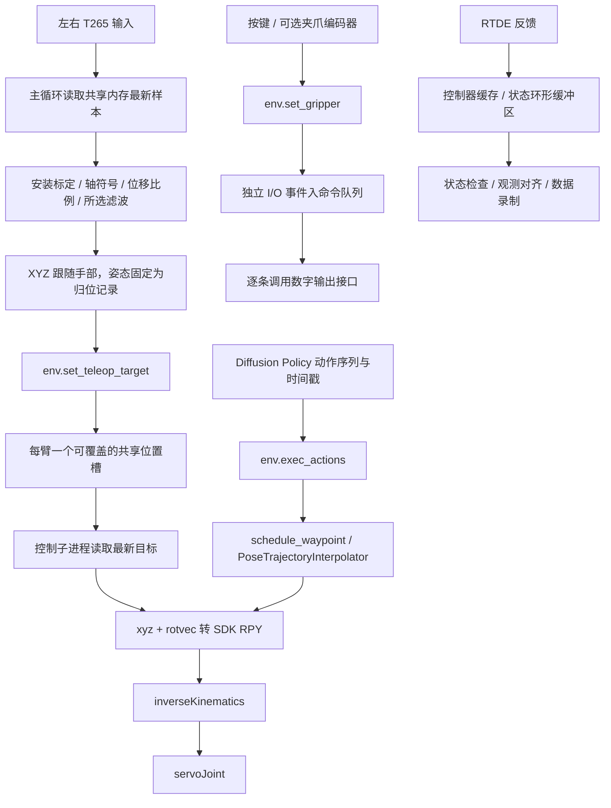

# AUBO 双臂遥操作 v2：当前控制逻辑与本次改动记录

## 1. 记录范围与 Git 基准

- 仓库：`/home/hy/Desktop/dp_pro6000`。
- 快照时间：`2026-10-08T15:40:02+08:00`。
- 后续补充：左臂 DO01 优先的四步 I/O 顺序，以及本节 2.7 的重力方向防碰桌限制；原快照统计和差异附录保留当时内容，当前高度逻辑以 2.7 节和实际代码为准。
- Git 基准：`6f4df0d2ec5ab6b5c804df338325ef851ae6be5f`。
- 基准提交：`Update AUBO teleop controls and home poses`，时间 `2026-10-08T13:58:48+08:00`。
- 范围：7 个已跟踪文件修改 + 2 个尚未跟踪的新增文件，共 9 个文件；本文自身不计入该快照。
- 已跟踪文件统计：新增 336 行、删除 85 行。


本文记录当前工作树相对 HEAD 的全部改动，包括 Git 尚未跟踪的新增配置和测试文件。
这些改动尚未形成新的 commit；本文不是某个已提交版本的发布说明。
完整 Git 补丁和新增文件内容见附录。

来源分为两类：

- **已有的工作树改动**：固定归位姿态、左臂归位记录更新、`dual.json` 速度参数调整，以及新增无平滑配置。左臂 A/V 四步 I/O 循环在本次修正过程中并行加入，并已合并保留。
- **本次实时遥操作修正**：最新位置覆盖、I/O 独立事件、取消实时到达时间、修正排程采样时序、绕过实时软件限速、累计周期调度，以及新增测试和说明。

Git 差异能确定修改内容，不能单独证明每个修改的操作者或操作先后。上述来源说明结合本次会话与保存的修改前文件，而非推断 Git 作者信息。

## 2. 当前控制方式

实时遥操作通过 `set_teleop_target()` 更新每臂的最新目标，机器人控制子进程持续执行 IK 和关节伺服。
目标没有必须在某个未来绝对时间到达的要求。Diffusion Policy 的多点动作排程仍通过 `exec_actions()` 提交。

### 2.1 三条控制路径



v2 入口读取 `DualTeleopInput` 提供的共享内存样本。虽然复用的 sender 文件名包含 UDP，当前入口读取目标的方式是共享内存。

### 2.2 频率与控制边界

| 环节 | 当前配置或代码值 | 含义 |
| --- | --- | --- |
| sender 发布 | 200 Hz | 输入发布频率，不等于机械臂指令频率 |
| 人控主循环 | 50 Hz | 每周期覆盖最新目标 |
| 每臂机器人控制循环 | 50 Hz | 名义周期 20 ms，实际周期受 IK、RPC 和调度耗时影响 |
| RTDE 订阅 / 状态配置 | 50 Hz | 反馈独立于运动 RPC 读取 |
| 观测 / 录制时间网格 | 10 Hz | 数据对齐频率，不是伺服频率 |
| `servo_t` | 0.02 s | 传给 `servoJoint` 的每步运动时间参数 |
| `speed_fraction` | 0.4 | 仍传给柜体，不属于此次绕过的 Python 速度限制 |

本次没有将人控降到 10 Hz。累计周期调度也不保证硬实时；超时后会跳过错过的周期，避免连续突发补发。

### 2.3 坐标、锚点与姿态

公开目标位姿为 `[x, y, z, rx, ry, rz]`：位置单位为米，后三项是旋转向量，单位为弧度，分别表达在各机械臂自己的 BASE 坐标系。
安装标定和轴符号仍由 Python 映射器处理；本次没有增加 SDK VIEW 坐标系控制入口。

开启遥操作或重新锚定时，手部当前位置与各臂实际 TCP 建立对应关系。位置处理仍包含位移比例、死区、配置中的滤波与可选空间范围处理。

`_load_home_rotvecs()` 从归位文件读取 `tcp_pose_aubo_rpy`，核对单位、IP、相机序列号和六维有限数值，再用：

```python
Rotation.from_euler('xyz', pose[3:]).as_rotvec()
```

生成目标姿态。主循环每次构造目标后，显式覆盖：

```python
left_target[3:] = home_rotvecs['left']
right_target[3:] = home_rotvecs['right']
```

因此当前手部运动只控制 XYZ，手部旋转不改变最终下发姿态。T 键仍切换内部旋转锁定标记并重新锚定，但最终目标姿态始终由归位记录决定。

### 2.4 最新目标共享槽

新增 `_LatestPose`：

- `mp.Array('d', 7, lock=False)` 存六维位姿和单调时钟接收时间。
- `mp.Value('Q', 0)` 存版本号，读写使用同一锁保护整个快照。
- `put()` 覆盖原位姿并递增版本号，位置更新不进入运动命令队列。
- `get()` 返回版本、位姿与接收时间。
- `clear()` 清空接收时间并递增版本号，使待处理位置失效。

`_consume_teleop()` 只接受未消费且未过期的版本。它更新 `target_pose`、设置 `teleop_active=True`、解除普通关节保持，并用实际接收时间刷新看门狗。
重复读取同一快照不会续期；超时快照不会重新激活运动。

此分支建立的单点 `PoseTrajectoryInterpolator` 只是保存当前目标，便于 HOLD 和路径切换；实时 `_target_joints()` 直接取 `target_pose`，不对它进行未来轨迹插值。
没有新目标时，控制器继续针对当前目标发送伺服指令，直到暂停、停止或看门狗退出。

### 2.5 I/O、暂停、停止与回零

I/O 与位置分别使用共享槽和事件队列。I/O 独立指的是事件提交与保存独立；数字输出 RPC 仍在机械臂控制子进程的循环内执行，没有另启独立 I/O 工作线程。

| 指令 / 情况 | 当前处理 |
| --- | --- |
| 位置更新 | 覆盖共享槽中的旧位置，不合并夹爪事件 |
| `GRIPPER_COMMAND=6` | 将每条输出事件加入 `immediate_gripper_events`，按顺序执行 |
| 同一批命令含 STOP | STOP 抢占整批，清除最新位置，退出循环，其他事件不再执行 |
| HOLD | 清除最新位置，保持最后成功接受的关节目标，取消未来排程的 I/O；独立即时 I/O 事件仍保留 |
| HOME | 清除最新位置，进入原六关节归位轨迹；归位运动中阻止笛卡尔目标提交 |
| HEARTBEAT | 只续看门狗，不解除 HOLD，也不产生运动目标 |
| 独立 `stop_event` | 循环入口、IK 后、I/O 执行期间及伺服前检查；可停止后续 I/O 与伺服提交 |

正在执行的 SDK 调用不能被这些 Python 检查同步取消；检查会在调用返回后的相应位置生效。
保留 RTDE 新鲜度、控制器健康、输入有效性、IK 返回值以及配置启用时的跟随误差检查。
当前 RTDE 过期阈值为 0.6 s；输入 `pose_timeout` 为 0.15 s，命令看门狗为 0.5 s。

### 2.6 左右 I/O 按键

| 按键 | 行为 |
| --- | --- |
| A 或 V | 左 DO00/DO01 依次经过 `00 → 01 → 11 → 10 → 00` |
| B | 左侧数采松开信号，忽略，不推进循环 |
| C | 右 DO00 取反一次 |
| D | 右侧组合信号中的伴随键，忽略 |

左臂配置 `pins=[0,1]` 时，按 `[DO00,DO01]` 顺序的四步对应位掩码 `2 → 3 → 1 → 0`。

最新顺序为“左臂双关 → DO01 开 → 左臂双开 → DO01 关 → 左臂双关”。文末补丁快照保留当时的旧顺序；当前执行顺序以本节和实际脚本为准。
每次推进或取反均立即调用 `env.set_gripper()`，同一周期内连续操作不会只留下最后一个状态。
可选 binary 编码器夹爪也在越过切换阈值时提交独立事件；independent 模式不走编码器切换逻辑。

数字输出反馈是输出锁存状态，不是实际夹爪位置或吸取成功反馈。原 `AuboDigitalGripper` 仍避免重复写入相同命令，并按原规则执行多引脚写入与锁存读取。

### 2.7 防止双臂碰桌：以重力方向为高度基准

**目的：限制左右机械臂的 TCP 向桌面方向下降，降低遥操、策略执行和归位过程碰桌的风险。当前高度边界的方向由重力确定，零点分别是左右机械臂各自的基座原点。**

对每臂，在 BASE 坐标系中定义：

```text
down_base = gravity / ||gravity||
up_base = -down_base
downward_distance = dot(down_base, TCP_xyz_base)
height = -downward_distance
```

`TCP_xyz_base` 是 TCP 相对本臂基座原点的位置，单位为米。
向下距离是这个位置在重力方向上的投影，不是相对启动 TCP 或重锚定 TCP 的位移。
因此 E/Z 重锚定、暂停再开启及 H 归位，都不会重置高度基准。
机械臂倾斜安装时，重力方向一般不等于 BASE 的负 Z，不能仅检查 `TCP_xyz_base[2]`。
当前也不以 T265 跟踪原点、人控 VIEW 坐标或统一世界原点作为高度零点。

| 项目 | 当前值 / 含义 |
| --- | --- |
| 方向依据 | 柜体安装重力向量；启动时读取并核验安装标定 |
| 左臂零点 | 左臂基座原点 |
| 右臂零点 | 右臂基座原点 |
| 高度边界 | `height >= -0.550 m`，允许恰好位于 −550 mm |
| 软件目标边界 | 同样为 −550 mm；取消 5 mm 余量 |
| 实际低于边界 | 例如 −551 mm 时向上恢复 1 mm 到 −550 mm；水平位置和姿态保持 |
| 检查对象 | 柜体当前 TCP，包括当前生效的 TCP 偏移 |

550 mm 是本次按现场需求设定的防碰桌距离，不是软件自动测量出的桌面位置。
如果左右基座原点不等高，两臂这两个边界平面的绝对高度也会不同；
应核对它们相对实际桌面的净空，以及吸盘、工件和其他工具是否低于 TCP。
TCP 高度检查不包含所有连杆或整套工具的几何碰撞检测。

#### 配置与执行路径

`dual.json` 和 `dual_no_smoothing.json` 均已启用以下配置：

```json
"workspace": {
  "enabled": true,
  "reference": "gravity_base",
  "max_downward_distance": 0.55,
  "target_margin": 0.0
}
```

`max_downward_distance=0.55`：实际 TCP 和运动目标均使用 `height >= -0.550 m`，允许恰好位于 550 mm 边界。
`target_margin=0.0`：取消目标余量，所有高度检查统一使用 −550 mm；非零余量配置会被拒绝。
这些单位均为米。限制对象是柜体当前 TCP，而不是机械臂的所有连杆。
倾斜安装时不能直接截断 BASE 的 Z；这里只修正重力方向分量，保留水平分量和姿态。
启动时使用柜体已核验的实时安装重力更新边界方向。

- 遥操：覆盖目标提交前投影到 550 mm 边界（例如 −551 mm 目标修正为 −550 mm），显示和录制保存修正后的目标。
- 策略：先检查整批 waypoint，越界则拒绝，不静默修改策略动作。
- 实际反馈：低于 −550 mm 时主动沿反重力方向恢复到 −550 mm；反馈值保持真实，不作截断。
- 归位：检查归位终点，并在每个待发关节目标上做 SDK `forwardKinematics` 检查。
- 所有 v2 伺服目标：IK/关节步长处理后，再做 FK 高度检查；失败或越界阻止下发。
- 停止请求：若发生在 FK 通信过程中，返回后不会继续发送伺服指令。

这增加了每轮一次 FK 通信，可能影响实际 50 Hz 周期，需要现场测量。
这是软件采样检查，不是连续运动的安全认证。
若必须保证实际 TCP 在任何瞬间都不穿过平面，还需配置 AUBO 控制柜安全平面、
工具 TCP 和与实际速度相符的停止余量。不得把“目标不越界”当作“实际绝不会越界”。
本次只有离线验证，没有连接机械臂或修改柜体安全配置。

离线回归见 `tests/test_gravity_height.py`，覆盖倾斜坐标、目标投影、双臂录制、
实际反馈、FK 错误、归位中间点和停止抢占。旧的统一世界模式仍需要实测 `world_from_base`。

## 3. 修正的时间处理问题

### 3.1 去除实时到达时间与旧位置排队

原入口每次用 `发送时刻 + command_latency` 构造绝对到达时间，调用 `exec_actions()`，左右目标分别进入 `schedule_waypoint()`。
当前实时入口调用 `set_teleop_target(action, stage)`，位置不再携带未来到达时间，`command_latency=0.04` 不参与该入口的目标控制。

### 3.2 排程更新与采样采用同一个时刻

v2 原代码先按 `curr_time=now+dt` 截取/更新轨迹，然后立即采样 `interpolator(now)`。
由于插值器会把早于起点的采样时刻夹到起点，该顺序可能提前取到下一周期的位置。

本次将 v2 的 `SERVOL` 和 `SCHEDULE_WAYPOINT` 更新时刻改为 `curr_time=now`。
`SERVOL` 的目标时刻也由 `now+dt+duration` 改为 `now+duration`。
`PoseTrajectoryInterpolator` 本身没有修改。

在原 40 ms 提前量、20 ms 周期下，目标排队 21 ms 后虽然还未到期，却可能因不足一个周期而被忽略。
修正后，该未来目标仍可排程；真正已到期的 waypoint 仍由既有插值逻辑忽略。
实时共享槽路径不使用这套到达时间判断，只检查快照的新旧与看门狗时效。

### 3.3 累计周期截止时间

主循环与 v2 控制循环都改为维护 `next_cycle`：

```python
next_cycle += period
finished = time.monotonic()
if next_cycle <= finished:
    next_cycle += (int((finished - next_cycle) / period) + 1) * period
```

主循环用 `precise_wait(next_cycle)` 等待，机器人控制循环用 `time.sleep()` 等待剩余时间。
周期基准不再每轮重新从完成/启动时刻累计漂移；超时不突发追发旧位置。

## 4. 软件限速、滤波与策略排程的边界

| 项目 | 当前实时遥操作 | 策略 / 旧排程接口 |
| --- | --- | --- |
| mapper 平移和转动速度限制 | `limit_speed=False` 绕过 | `step()` 默认 `limit_speed=True` |
| Python Cartesian 插值速度限制 | 实时直接目标不使用 | 仍按 `max_pos_speed / max_rot_speed` 插值 |
| 关节步长 / 关节速度 / 跳变拒绝分支 | `teleop_active=True` 时绕过，仍验证 IK 结果形状和有限值 | 仍执行原配置分支 |
| 新增加速度约束 | 没有增加 | 没有在本次增加 |
| 滤波 | 读取所选配置 | 原调用行为保留 |
| SDK 参数、柜体速度比例和柜体自身限制 | 继续由原配置与控制器执行 | 继续由原配置与控制器执行 |
| HOME 速度/加速度轨迹 | HOME 独立使用原 `JointHome` | 原归位行为保留 |

`dual_no_smoothing.json` 将 `smooth_alpha` 和 `rotation_smooth_alpha` 设为 1.0，映射器时间常数变为 0，关闭该层低通滤波。
它仍保留死区和标定处理；“无平滑”不表示柜体内部运动处理被禁用。
默认入口仍读取 `dual.json`，需要显式 `--config` 才选择无平滑配置。

实时目标覆盖与取消软件限速没有新增连续加速度轨迹整形。目标跳变可直接进入 IK 和关节目标；本次离线结果不能证明真机已经更平滑。

## 5. 按文件列出的全部修改

| Git 状态 | 文件 | 新增 / 删除行 | 当前文件 SHA-256 前 12 位 |
| --- | --- | --- | --- |
| M | [demo_dual_teleop_aubo_v2.py](../demo_dual_teleop_aubo_v2.py) | +114 / -26 | `07ab11197f37` |
| M | [diffusion_policy/envs/realword/aubo_interpolation_controller_v2.py](../diffusion_policy/envs/realword/aubo_interpolation_controller_v2.py) | +119 / -17 | `c178282ee6aa` |
| M | [diffusion_policy/envs/realword/aubo_t265/README_v2.md](../diffusion_policy/envs/realword/aubo_t265/README_v2.md) | +30 / -21 | `046d64118611` |
| M | [diffusion_policy/envs/realword/aubo_t265/config/dual.json](../diffusion_policy/envs/realword/aubo_t265/config/dual.json) | +1 / -1 | `d2314991965f` |
| M | [diffusion_policy/envs/realword/aubo_t265/config/home_positions.json](../diffusion_policy/envs/realword/aubo_t265/config/home_positions.json) | +12 / -12 | `fb587e4c4af0` |
| M | [diffusion_policy/envs/realword/aubo_t265/pose_mapper.py](../diffusion_policy/envs/realword/aubo_t265/pose_mapper.py) | +7 / -8 | `42742b48fbd9` |
| M | [diffusion_policy/envs/realword/dual_aubo_real_env_v2.py](../diffusion_policy/envs/realword/dual_aubo_real_env_v2.py) | +53 / -0 | `913b7c939c60` |
| ?? | [diffusion_policy/envs/realword/aubo_t265/config/dual_no_smoothing.json](../diffusion_policy/envs/realword/aubo_t265/config/dual_no_smoothing.json) | +44 / -0 | `b808d4b83223` |
| ?? | [diffusion_policy/envs/realword/aubo_t265/tests/test_latest_teleop.py](../diffusion_policy/envs/realword/aubo_t265/tests/test_latest_teleop.py) | +303 / -0 | `916a0d7c4886` |

### 5.1 `demo_dual_teleop_aubo_v2.py`

| 函数 / 位置 | 相对 HEAD 的改动 |
| --- | --- |
| 文件说明与 import | 说明实时目标覆盖和固定归位姿态；新增 `json`、`Path`、`Rotation` 用于读取归位朝向 |
| `_target_from_anchor()` | 调用 mapper 时传 `limit_speed=False`；保留坐标处理和滤波 |
| 新增 `_load_home_rotvecs()` | 校验归位数据与左右 IP/相机匹配，将归位 RPY 转为 rotvec |
| `_toggle_output()` | 更新电平后立即提交独立 I/O 事件 |
| 新增 `_advance_left_output()` | 实现 A/V 左臂四步输出循环，每步单独提交 |
| `_update_encoder_outputs()` | binary 编码器触发后单独提交夹爪事件 |
| `run()` 初始化 | 加载两臂归位姿态，初始化累计 `next_cycle`，增加实时模式提示 |
| `run()` 按键 | A/V 推进左四步，B 忽略，C 控制右输出；提示对应更新 |
| `run()` 录制开始 | 由未来目标时刻改为 `time.time()`，与实时提交时间语义一致 |
| `run()` 动作生成 | 覆盖两臂目标旋转为各自归位姿态，只跟随 XYZ |
| `run()` 位置提交 | `exec_actions(actions,timestamps,stages)` 改为 `set_teleop_target(action,stage)` |
| `run()` 等待 | 删除实时 `t_command_target / t_cycle_end`；改为累计周期并跳过错过的周期 |
| `main()` 配置检查 | 增加归位朝向校验，仍可离线执行 `--check-config` |

### 5.2 `aubo_interpolation_controller_v2.py`

| 类 / 函数 | 改动 |
| --- | --- |
| import、命令常量 | 新增 `multiprocessing`；新增 v2 专用 `GRIPPER_COMMAND=6`，不修改 v1 的 `Command` 枚举 |
| `_LatestPose` | 新增原子共享位置快照，提供 `put/get/clear` |
| `_LoopState` | 新增 `teleop_revision`、`teleop_active`、`immediate_gripper_events` |
| `__init__()` | 创建实时目标共享槽 |
| `set_teleop_target()` | 校验六维有限位姿、就绪/停止/归位状态，再覆盖共享槽 |
| `set_gripper()` | 校验输出与控制器状态，事件逐条入队 |
| `_discard_teleop()` | 清除待处理位置并退出实时分支 |
| `_consume_teleop()` | 仅接受新且未过期的快照，用接收时间刷新看门狗 |
| `_process_commands()` | STOP/HOLD/HOME 抢占或取消最新位置；HOLD 保留即时 I/O；消费最新位置后检查看门狗 |
| `_process_commands()` 旧排程分支 | 保留逐个 waypoint；更新时刻改为 `now`，进入排程时清除实时槽 |
| `_target_joints()` | 实时分支直接求 IK，绕过软件关节步长/速度/跳变约束，检查结果有效性；其他分支按原配置 |
| `run()` | 逐条执行即时 I/O；增加停止检查；使用累计周期调度 |

RTDE 读取、SDK IK 转换、`servoJoint` 格式、返回码处理及进程清理仍复用原有实现：成功才更新 IK 种子，队列满不推进种子，`-13` 按已有逻辑重新选择模式 1 并等待。

### 5.3 `dual_aubo_real_env_v2.py`

- 新增 `set_gripper(side, values)`：校验所选臂、输出维数和二进制电平，编码后提交独立事件。
- 新增 `set_teleop_target(action, stage=0)`：校验整条 action、stage、两臂状态与配置中的工作空间后，分别覆盖两臂目标。
- action 中的输出列用于校验和录制，不能通过此接口触发 I/O；实际输出事件需要 `set_gripper()`。
- 左右任一提交失败时执行原环境停止逻辑。
- 录制 action/stage 使用目标提交时的 Unix 时间，不再记录未来到达时间。
- 左右目标分别写入独立共享槽，本次没有新增双臂共同到达的时间屏障。

无 I/O 时 action 为 12 维；启用当前左两路、右一路 I/O 后为 15 维：

```text
[left_xyz_rotvec(6), left_DO00, left_DO01, right_xyz_rotvec(6), right_DO00]
```

action 是目标，实际运动反馈仍在观测字段中记录；提交时间不是机械臂实际到达该位置的时间。

### 5.4 `aubo_t265/pose_mapper.py`

`QuaternionPoseMapper.step()` 新增关键字参数 `limit_speed=True`。
平移先计算滤波后的 `position_step`，旋转先计算滤波后的相对旋转步长；只有开关为 True 时才应用 `speed*dt` 或 `angular_speed*dt` 上限。
v2 实时入口显式关闭该开关，原调用的默认行为保留。

### 5.5 `aubo_t265/config/dual.json`

相对 HEAD 只有 `motion.max_speed` 从 **0.05 m/s** 调整为 **0.1 m/s**。
这是已存在的配置修改；新的 v2 实时路径绕过此软件速度上限，但其他使用该字段的原路径仍可受它影响。

### 5.6 `aubo_t265/config/home_positions.json`

只更新左臂 `joint_positions_rad` 和 `tcp_pose_aubo_rpy` 两个数组。右臂记录、IP、序列号、单位和 `recorded_at` 字段相对 HEAD 没有变化。
`recorded_at` 没有随该数组更新而重写，不能把它作为本次左臂修改的时间证明。

| 左臂字段 | HEAD 记录 | 当前工作树记录 |
| --- | --- | --- |
| 关节 1 / rad | `3.484872560238456` | `3.4041666586330974` |
| 关节 2 / rad | `0.48547705888829107` | `0.3707540818687839` |
| 关节 3 / rad | `-1.5483886356027259` | `-1.9327083120773934` |
| 关节 4 / rad | `0.4876888837302638` | `0.02981121086393851` |
| 关节 5 / rad | `0.48336553496840207` | `0.3816973426455838` |
| 关节 6 / rad | `-0.9850377486287178` | `-0.7592425267572261` |
| TCP x / m | `0.5164844460053808` | `0.4533517074944937` |
| TCP y / m | `0.40327215034200165` | `0.3390603753767256` |
| TCP z / m | `0.2571751281328827` | `0.20558796417862615` |
| TCP roll / rad | `-0.0820194252271029` | `-0.14576756135563002` |
| TCP pitch / rad | `-1.2946070016632518` | `-1.293549321789655` |
| TCP yaw / rad | `-1.5459934777282347` | `-1.4275968114767852` |

归位关节用于 H 键；归位 TCP 姿态还用于本入口的固定目标朝向。当前固定姿态的变化来源于此记录，而不是手部旋转。

### 5.7 新增 `aubo_t265/config/dual_no_smoothing.json`

该文件尚未被 Git 跟踪。相对当前 `dual.json`，数值配置的差别只有：

| 参数 | `dual.json` | `dual_no_smoothing.json` |
| --- | --- | --- |
| `smooth_alpha` | 0.35 | 1.0 |
| `rotation_smooth_alpha` | 0.7 | 1.0 |

其余内容相同，包括 50/50/50 Hz、10 Hz 录制、1.5 倍位置比例、两臂 `no_range_limit=true`、0.0002 m 死区、0.02 s `servo_t`、0.4 柜体速度比例。
配置中的 `gripper.type` 默认仍是 `disabled`；入口的 `--enable-io` 在内存中将两臂改为 `standard_digital`，不改写 JSON。

当前配置设备对应关系为：

| 手臂 | 柜体 IP | T265 序列号 | 输出配置 |
| --- | --- | --- | --- |
| 左 | 192.168.3.200 | 224622111506 | DO00、DO01 |
| 右 | 192.168.2.200 | 121222110870 | DO00 |

### 5.8 `aubo_t265/README_v2.md`

更新入口流程、共享槽和事件队列图、按键表、实时约束边界、时间修正和验证方式。
旧 `测试/aubo_v2_compare/results` 对应旧版排程逻辑，文档已说明不能用作当前覆盖模式的数值验收。

### 5.9 新增 `aubo_t265/tests/test_latest_teleop.py`

新增 **19 项**离线测试。覆盖共享槽跨进程访问、位置覆盖而不占用命令队列、绕过实时限速、输入过期和看门狗、HOLD/STOP/HOME、21 ms 排队、采样连续性、策略 waypoint/I/O 保留、左右 action 布局、编码器与左四步输出等。

- `RealtimeTests.test_slot_is_shared_and_never_accumulates_old_poses`
- `RealtimeTests.test_pose_publication_does_not_enqueue_motion`
- `RealtimeTests.test_latest_goal_used_without_joint_speed_or_step_limit`
- `RealtimeTests.test_same_snapshot_does_not_refresh_watchdog`
- `RealtimeTests.test_stale_snapshot_cannot_resume_motion`
- `RealtimeTests.test_hold_discards_goal_but_preserves_all_immediate_io`
- `RealtimeTests.test_stop_preempts_goal_and_io`
- `RealtimeTests.test_home_cancels_pending_realtime_goal`
- `RealtimeTests.test_future_waypoint_survives_21ms_queue_delay`
- `RealtimeTests.test_replanning_does_not_jump_current_sample_into_future`
- `RealtimeTests.test_run_delivers_each_io_event_and_only_latest_goal_before_stop`
- `RealtimeTests.test_stop_event_during_io_prevents_remaining_io_and_servo`
- `RealtimeTests.test_policy_chunk_keeps_ordered_waypoints_and_timed_io`
- `EntryAndEnvironmentTests.test_target_records_outputs_but_only_sends_poses`
- `EntryAndEnvironmentTests.test_repeated_key_toggles_are_separate_io_events`
- `EntryAndEnvironmentTests.test_encoder_edge_is_an_independent_event`
- `EntryAndEnvironmentTests.test_left_four_step_sequence_keeps_every_transition`
- `EntryAndEnvironmentTests.test_realtime_mapper_ignores_configured_speed_limits`
- `EntryAndEnvironmentTests.test_invalid_right_output_blocks_both_position_submissions`

## 6. 验证结果与适用范围

上一轮代码修改完成后，在实际仓库 `/home/hy/Desktop/dp_pro6000`、`robodiff` Python 环境中完成：

- 全部 AUBO T265 离线测试 **76 项通过**，失败 0、错误 0，其中新增 19 项、原有 57 项。
- `dual_no_smoothing.json` 的 `--check-config` 检查通过。
- `git diff --check` 通过。
- 测试导入的 v2 控制器与环境确认为实际仓库文件，而非临时暂存版本。

测试使用 SDK/机械臂替身，没有连接真机、发送机械运动目标或切换真实 I/O。
未测量现场 IK/RPC 延迟、实际伺服频率、队列满发生率、机械臂跟随误差或运动平滑度。
本次生成说明文件沿用上述已完成的验证结果，不重新执行机械运动测试。

## 7. 运行与复查

```bash
cd /home/hy/Desktop/dp_pro6000
conda activate robodiff

# 配置检查：不连接设备
python demo_dual_teleop_aubo_v2.py \
  --config diffusion_policy/envs/realword/aubo_t265/config/dual_no_smoothing.json \
  --check-config

# 离线逻辑测试：使用替身
python -m unittest discover \
  -s diffusion_policy/envs/realword/aubo_t265/tests -v

# 真实遥操作与 I/O：启动后仍初始暂停，E 开启，R 开始录制
python demo_dual_teleop_aubo_v2.py \
  --config diffusion_policy/envs/realword/aubo_t265/config/dual_no_smoothing.json \
  --enable-motion --enable-io --output data/1008
```

代码修正本身没有创建 commit，也没有修改 Conda 环境。以后若继续改动，请使用下列命令与本文保存的快照核对：

```bash
git status --short
git diff HEAD --stat
git diff HEAD -- demo_dual_teleop_aubo_v2.py \
  diffusion_policy/envs/realword/aubo_interpolation_controller_v2.py \
  diffusion_policy/envs/realword/dual_aubo_real_env_v2.py
```

## 8. 完整差异附录

下列补丁为生成本文时保存的文件级差异。已跟踪文件来自 `git diff HEAD`；新增文件使用 `git diff --no-index /dev/null <文件>` 生成，因而包含完整内容。
附录不包括本文自身，也不包含此前 commit 的整仓库内容。

<details>
<summary>展开完整 Git 差异和新增文件内容</summary>

````diff
diff --git a/demo_dual_teleop_aubo_v2.py b/demo_dual_teleop_aubo_v2.py
index d8c9154..b52ae20 100644
--- a/demo_dual_teleop_aubo_v2.py
+++ b/demo_dual_teleop_aubo_v2.py
@@ -2,23 +2,27 @@
 """双臂 Aubo 遥操 v2：按 demo_dual_udp_teleop_franka_v3.py 的流程组织。
 
 初始化输入/环境 → 捕获锚点 → 读取观测 → 处理按键 → 计算左右目标
-→ env.exec_actions → 等待下一周期。主循环直接展示状态和下发动作。
-沿用已验证的 Aubo 安装标定、四元数映射、滤波/限速与伺服参数。
+→ env.set_teleop_target → 等待下一周期。位置目标覆盖更新，I/O 独立排队。
+沿用 Aubo 安装标定、四元数映射、滤波与伺服参数；实时路径不做软件限速。
+遥操目标姿态始终采用各臂归位记录，仅 XYZ 跟随手部运动。
 
 E 开关遥操，Z 重新锚定，T 锁定旋转，R 开始录制并开启遥操，
 S 保存并暂停，H 六关节回零，Space 增加 stage，Q/Esc 退出。
-V/B 切换左 DO00/DO01，数采按钮的 C/D 组合信号切换右 DO00，1/2/3 切换相机。
+A/B 按下和松开推进左 DO00/DO01 四步循环一次（只响应 A，V 同效），数采按钮的 C/D 组合信号切换右 DO00，1/2/3 切换相机。
 默认只读预览；--enable-motion 启动伺服，--enable-io 启用已配置的柜体输出。
 """
 from __future__ import annotations
 
 import argparse
 from contextlib import ExitStack
+import json
 from multiprocessing.managers import SharedMemoryManager
+from pathlib import Path
 import sys
 import time
 
 import numpy as np
+from scipy.spatial.transform import Rotation
 
 from diffusion_policy.common.precise_sleep import precise_wait
 from diffusion_policy.envs.realword.aubo_homing import load_home
@@ -47,14 +51,32 @@ def _capture_teleop_anchor(poses, samples, mappers):
 
 
 def _target_from_anchor(mapper, sample, dt, lock_rot=False):
-    """原 Aubo 映射器执行 B/C 坐标变换、左右轴符号、相对四元数、滤波与限速。
+    """映射器执行坐标变换、轴符号与滤波，实时人控不做速度约束。
 
-    普通遥操和 v1 相同。锁旋转时用锚点的手部朝向，目标保持在锚点朝向；
+    锁旋转时用锚点的手部朝向，目标保持在锚点朝向；
     主循环在锁定/解锁时重新锚定，避免切换时向旧手部旋转目标追赶。
     """
-    # 锁旋转只替换朝向输入，平移仍跟随手部；dt 用于按实际周期限速。
+    # 锁旋转只替换朝向输入；保留配置中的低通滤波和空间范围处理。
     orientation = mapper.hand_rotation if lock_rot else sample.orientation
-    return mapper.step(sample.position, orientation, dt)
+    return mapper.step(sample.position, orientation, dt, limit_speed=False)
+
+
+def _load_home_rotvecs(home_file, arms):
+    """Load each arm's recorded TCP orientation as an action rotation vector."""
+    data = json.loads(Path(home_file).read_text(encoding='utf-8'))
+    if data.get('units') != 'radians':
+        raise ValueError('Recorded home orientations must be in radians')
+    rotations = {}
+    for side, arm in arms.items():
+        matches = [entry for entry in data['arms']
+                   if entry['ip'] == arm['ip'] and entry['serial'] == arm['serial']]
+        if len(matches) != 1:
+            raise ValueError(f'{side} home orientation does not match its IP and T265 serial')
+        pose = np.asarray(matches[0]['tcp_pose_aubo_rpy'], dtype=np.float64)
+        if pose.shape != (6,) or not np.isfinite(pose).all():
+            raise ValueError(f'{side} home TCP pose must have six finite values')
+        rotations[side] = Rotation.from_euler('xyz', pose[3:]).as_rotvec()
+    return rotations
 
 
 # ===========================================================================
@@ -75,6 +97,39 @@ def _read_output_state(env):
     return outputs
 
 
+def _initialize_output_state(env):
+    """Initialize left DO00/DO01 and right DO00 low before accepting input."""
+    outputs = _read_output_state(env)
+    if env is None or not env.grippers_enabled:
+        return outputs
+    targets = {}
+    for side, required_pins in (('left', (0, 1)), ('right', (0,))):
+        settings = env.gripper_configs[side]
+        pins = settings.get('pins', [])
+        if settings.get('mode') != 'independent' or not all(pin in pins for pin in required_pins):
+            raise RuntimeError(f'{side} startup requires independent outputs {required_pins}')
+        target = outputs[side].copy()
+        target[[pins.index(pin) for pin in required_pins]] = 0.
+        targets[side] = target
+    for side, target in targets.items():
+        env.set_gripper(side, target)
+    # Confirm both asynchronous writes while maintaining the servo watchdogs.
+    deadline = time.monotonic() + 2.
+    while True:
+        env.heartbeat()
+        state = env.get_state()
+        actual = {side: env.decode_gripper(side, state[side]['GripperState'])[0].copy()
+                  for side in targets}
+        pending = [side for side in targets if not np.array_equal(actual[side], targets[side])]
+        if not pending:
+            outputs.update(actual)
+            print('IO initialized: left DO00=LOW, DO01=LOW; right DO00=LOW')
+            return outputs
+        if time.monotonic() >= deadline:
+            raise RuntimeError(f'Startup LOW was not confirmed within 2 seconds: {pending}')
+        time.sleep(.02)
+
+
 def _toggle_output(env, outputs, side, pin, teleop_enabled):
     # 仅在启用 I/O 且遥操运行时接受按键；暂停时不改缓存电平。
     if env is None or not env.grippers_enabled or not teleop_enabled:
@@ -82,12 +137,34 @@ def _toggle_output(env, outputs, side, pin, teleop_enabled):
     settings = env.gripper_configs[side]
     if settings.get('mode') != 'independent' or pin not in settings['pins']:
         raise RuntimeError('This key requires an explicitly configured independent cabinet output')
-    # 引脚号先映射到动作数组位置；这里只更新目标，由 exec_actions 统一下发。
+    # 每次按键都提交独立事件，连续两次取反也不会被位置覆盖或合并。
     index = settings['pins'].index(pin)
     outputs[side][index] = 1. - outputs[side][index]
+    env.set_gripper(side, outputs[side])
     return outputs[side][index]
 
 
+def _advance_left_output(env, outputs, teleop_enabled):
+    """One A press advances DO00/DO01 through 00 -> 10 -> 11 -> 01 -> 00."""
+    if env is None or not env.grippers_enabled or not teleop_enabled:
+        raise RuntimeError('Enable I/O and resume teleoperation before toggling outputs')
+    settings = env.gripper_configs['left']
+    pins = settings.get('pins', [])
+    if settings.get('mode') != 'independent' or not all(pin in pins for pin in (0, 1)):
+        raise RuntimeError('Left sequence requires independent DO00 and DO01')
+    indices = [pins.index(0), pins.index(1)]
+    cycle = ((0., 0.), (1., 0.), (1., 1.), (0., 1.))
+    current = tuple(outputs['left'][indices])
+    if current not in cycle:
+        raise RuntimeError('Left output levels are unknown; cannot advance sequence')
+    next_index = (cycle.index(current) + 1) % len(cycle)
+    target = outputs['left'].copy()
+    target[indices] = cycle[next_index]
+    env.set_gripper('left', target)
+    outputs['left'] = target
+    return next_index, cycle[next_index]
+
+
 def _update_encoder_outputs(env, outputs, samples, anchors, toggled, threshold):
     """保留 v1 对可选 binary 编码器夹爪的支持；V/B/C 的 independent 模式不走这里。"""
     if env is None or not env.grippers_enabled:
@@ -103,6 +180,7 @@ def _update_encoder_outputs(env, outputs, samples, anchors, toggled, threshold):
         delta = abs((sample.encoder_angle - anchor + 180.) % 360. - 180.)
         if delta > threshold and not toggled[side]:
             outputs[side][0] = 1. - outputs[side][0]
+            env.set_gripper(side, outputs[side])
             toggled[side] = True
         elif delta < threshold * .5:
             # 回到半阈值以内才允许再次触发，形成滞回以避免反复切换。
@@ -181,6 +259,7 @@ def run(args, config):
     motion = config['motion']
     arms = {arm['side']: arm for arm in config['arms']}
     homes = {side: load_home(config['home_file'], arm['ip'], arm['serial']) for side, arm in arms.items()}
+    home_rotvecs = _load_home_rotvecs(config['home_file'], arms)
     workspace = DualWorkspace(config['arms'], config['workspace'])
     # 按进入顺序注册资源，退出时反向清理，异常路径也停止设备进程。
     with ExitStack() as stack:
@@ -226,7 +305,7 @@ def run(args, config):
         poses = ({side: state['ActualTCPPose'].copy() for side, state in env.get_state().items()} if env else
                  {side: state['tcp_pose_rotvec'].copy() for side, state in statuses.items()})
         mappers = make_mappers(config, poses)
-        outputs = _read_output_state(env)
+        outputs = _initialize_output_state(env)
         teleop_anchor, encoder_anchors, encoder_toggled = {}, {}, {}
         teleop_enabled = homing = lock_rot = is_recording = False
         stage, vis_camera_idx = 0, args.vis_camera_idx
@@ -257,18 +336,18 @@ def run(args, config):
             teleop_enabled = is_recording = False
 
         print('E: teleop; Z: anchor; T: rotation lock; R/S: record/save; H: home; Space: stage; Q/Esc: quit')
-        print('V: toggle left DO00; B: toggle left DO01; C(+D): toggle right DO00; 1/2/3: camera')
+        print('A(+B), or V: left IO cycle 00 -> 10 -> 11 -> 01 -> 00; B: release ignored; C(+D): toggle right DO00; 1/2/3: camera')
         print('MOTION ENABLED, initially paused' if env else 'READ-ONLY PREVIEW, initially paused')
+        print('Realtime mode: latest XYZ target; independent I/O events; no arrival deadline or software speed limits')
         period = 1. / motion['teleop_frequency']
         # 周期/超时用单调时钟；下发环境和录制时才转换为 Unix 时间。
         t_start = previous = time.monotonic()
+        next_cycle = t_start
         next_obs = next_report = t_start
         stop, obs = False, None
         while not stop and (args.duration is None or time.monotonic() - t_start < args.duration):
-            # 与 Franka 相同的周期/命令时间变量；保持 Aubo 的 40 ms 调度提前量。
+            # 实时目标没有未来到达时间；周期使用单调时钟。
             t_cycle_start = time.monotonic()
-            t_cycle_end = t_cycle_start + period
-            t_command_target = t_cycle_start + motion['command_latency']
             actual_dt, previous = max(1e-6, t_cycle_start - previous), t_cycle_start
 
             # ---- 4. 获取共享内存输入和观测：任何手部失效都暂停整对机械臂 ----
@@ -317,7 +396,7 @@ def run(args, config):
                     elif not env._recording and refresh_anchor(samples):
                         stage = 0
                         teleop_enabled = True
-                        env.start_episode(t_command_target - time.monotonic() + time.time())
+                        env.start_episode(time.time())
                         is_recording = True
                 elif character == 's' and not homing:
                     pause()  # 保存当前 episode，并像 Franka 的 S 一样关闭遥操。
@@ -333,15 +412,20 @@ def run(args, config):
                     is_recording = False
                 elif key == Key.space:
                     stage += 1  # Space 是录制 stage 标记，不再是遥操开关。
-                elif character in ('v', 'b', 'c'):
+                elif character in ('a', 'v', 'b', 'c'):
                     # 数采设备每次按下会连续发 C、D：只响应 C 取反一次，D 不处理。
                     try:
-                        if character in ('v', 'b'):
-                            side, pin = ('left', 0 if character == 'v' else 1)
+                        if character in ('a', 'v'):
+                            step, levels = _advance_left_output(env, outputs, teleop_enabled)
+                            print(f'left IO step {step or 4}/4 requested: '
+                                  f'DO00={"HIGH" if levels[0] else "LOW"}, '
+                                  f'DO01={"HIGH" if levels[1] else "LOW"}')
+                        elif character == 'b':
+                            print('Left IO: B ignored; A advances the four-step sequence; B is the release event')
                         else:
                             side, pin = 'right', 0
-                        level = _toggle_output(env, outputs, side, pin, teleop_enabled)
-                        print(f'{side} DO{pin:02d} requested: {"HIGH" if level else "LOW"}')
+                            level = _toggle_output(env, outputs, side, pin, teleop_enabled)
+                            print(f'{side} DO{pin:02d} requested: {"HIGH" if level else "LOW"}')
                     except RuntimeError as exc:
                         print(exc)
                 elif character in ('1', '2', '3'):
@@ -368,18 +452,17 @@ def run(args, config):
                 # 各臂独立按安装坐标映射；双方目标通过工作空间检查后才统一下发。
                 left_target = _target_from_anchor(mappers['left'], samples['left'], actual_dt, lock_rot)
                 right_target = _target_from_anchor(mappers['right'], samples['right'], actual_dt, lock_rot)
+                # 遥操仅沿 XYZ 平移；姿态固定为各臂归位记录的 TCP 朝向。
+                left_target[3:] = home_rotvecs['left']
+                right_target[3:] = home_rotvecs['right']
                 workspace.validate('left', left_target)
                 workspace.validate('right', right_target)
                 _update_encoder_outputs(env, outputs, samples, encoder_anchors, encoder_toggled,
                                         motion.get('gripper_toggle_deg', 30.))
                 action = _build_action(left_target, right_target, outputs, env)
-                # ---- 7. 与 Franka 一样显式下发 actions/timestamps/stages ----
+                # ---- 7. 覆盖最新位置；输出已由独立事件入口提交 ----
                 if env:
-                    # Aubo 的提前量从实际发送时刻计算，避免观测/按键耗时后目标已过期。
-                    t_command_target = time.monotonic() + motion['command_latency']
-                    env.exec_actions(actions=[action],
-                                     timestamps=[t_command_target - time.monotonic() + time.time()],
-                                     stages=[stage])
+                    env.set_teleop_target(action, stage=stage)
                 poses = {'left': left_target.copy(), 'right': right_target.copy()}
 
             # ---- 8. 可视化与诊断：与观测一起降频，避免拖慢 50 Hz 遥操 ----
@@ -399,7 +482,11 @@ def run(args, config):
                 next_report = t_cycle_start + 2.
 
             # ---- 9. 等待下一周期：与 Franka 的 precise_wait 调度方式相同 ----
-            precise_wait(t_cycle_end)
+            next_cycle += period
+            finished = time.monotonic()
+            if next_cycle <= finished:
+                next_cycle += (int((finished - next_cycle) / period) + 1) * period
+            precise_wait(next_cycle)
         # 离开 with 后自动保存有效 episode、停止控制器和 sender，并释放共享内存/锁。
 
 
@@ -428,6 +515,7 @@ def main(argv=None):
         # 离线校验配置、回零文件及工作空间后返回，不调用 run 的设备初始化。
         for arm in config['arms']:
             load_home(config['home_file'], arm['ip'], arm['serial'])
+        _load_home_rotvecs(config['home_file'], {arm['side']: arm for arm in config['arms']})
         DualWorkspace(config['arms'], config['workspace'])
         print('Configuration valid; no SDK, robot, camera, or I/O accessed.')
         return
diff --git a/diffusion_policy/envs/realword/aubo_interpolation_controller_v2.py b/diffusion_policy/envs/realword/aubo_interpolation_controller_v2.py
index c12ccf5..3531765 100644
--- a/diffusion_policy/envs/realword/aubo_interpolation_controller_v2.py
+++ b/diffusion_policy/envs/realword/aubo_interpolation_controller_v2.py
@@ -10,6 +10,7 @@ from __future__ import annotations
 
 from collections import deque
 from dataclasses import dataclass, field
+import multiprocessing as mp
 import os
 import time
 
@@ -24,6 +25,33 @@ from diffusion_policy.envs.realword.aubo_interpolation_controller import (
     SharedMemoryQueue, SharedMemoryRingBuffer,
 )
 
+# v2-only reliable event; position updates use a separate overwriteable slot.
+GRIPPER_COMMAND = 6
+
+
+class _LatestPose:
+    """One atomic pose snapshot, shared by the parent and servo process."""
+
+    def __init__(self):
+        self.data = mp.Array('d', 7, lock=False)  # xyz/rotvec + monotonic receipt time
+        self.revision = mp.Value('Q', 0)
+
+    def put(self, pose, received):
+        with self.revision.get_lock():
+            self.data[:6] = pose
+            self.data[6] = received
+            self.revision.value += 1
+
+    def get(self):
+        with self.revision.get_lock():
+            return self.revision.value, np.array(self.data[:6]), self.data[6]
+
+    def clear(self):
+        with self.revision.get_lock():
+            self.data[6] = 0.
+            self.revision.value += 1
+            return self.revision.value
+
 
 # ========= robot interface（对应 FrankaInterface） =========
 class AuboInterface:
@@ -160,6 +188,9 @@ class _LoopState:
     gripper_events: deque = field(default_factory=deque)
     ik_failed: int = 0
     servo_ignored: int = 0
+    teleop_revision: int = 0
+    teleop_active: bool = False
+    immediate_gripper_events: deque = field(default_factory=deque)
 
 
 # ========= interpolation controller（对应 FrankaInterpolationController） =========
@@ -178,6 +209,48 @@ class AuboInterpolationControllerV2(_AuboController):
         super().__init__(*args, **kwargs)
         # 标记进程版本，便于终端和进程列表区分左右 v2 控制器。
         self.name = f'AuboControllerV2-{self.robot_ip}'
+        self.latest_teleop_pose = _LatestPose()
+
+    def set_teleop_target(self, pose):
+        """Replace the realtime goal, without an arrival deadline or speed limit."""
+        pose = np.asarray(pose, dtype=np.float64)
+        if pose.shape != (6,) or not np.isfinite(pose).all():
+            raise ValueError('Teleop pose must be finite xyz+rotvec with shape (6,)')
+        if not self.is_ready or self.stop_event.is_set():
+            raise RuntimeError('Controller is not ready for teleoperation')
+        if self.home_state.value == 1:
+            raise RuntimeError('Cartesian targets are blocked during joint homing')
+        self.latest_teleop_pose.put(pose, time.monotonic())
+
+    def set_gripper(self, value):
+        """Enqueue every I/O transition independently of position updates."""
+        AuboDigitalGripper(None, self.gripper_config).validate_command(value)
+        if not self.is_ready or self.stop_event.is_set():
+            raise RuntimeError('Controller is not ready for I/O')
+        self.input_queue.put({'cmd': GRIPPER_COMMAND, 'gripper': float(value)})
+
+    def _discard_teleop(self, loop):
+        loop.teleop_revision = self.latest_teleop_pose.clear()
+        loop.teleop_active = False
+
+    def _consume_teleop(self, loop, now):
+        revision, pose, received = self.latest_teleop_pose.get()
+        if not received or revision == loop.teleop_revision:
+            return
+        loop.teleop_revision = revision
+        if self.command_timeout is not None and now - received > self.command_timeout:
+            return  # An old mailbox snapshot cannot revive the watchdog.
+        if loop.home_plan is not None:
+            if self.home_state.value == 1:
+                return
+            loop.home_plan = None
+            self.home_state.value = 0
+        loop.last_command_at = max(loop.last_command_at, received)
+        loop.joint_hold = False
+        loop.teleop_active = True
+        loop.target_pose = pose
+        loop.interpolator = PoseTrajectoryInterpolator([now], [pose])
+        loop.last_waypoint_time = now
 
     # ========= command APIs =========
     # servoL、schedule_waypoint、return_home、hold、heartbeat 沿用同一队列协议。
@@ -189,10 +262,12 @@ class AuboInterpolationControllerV2(_AuboController):
             count = len(commands['cmd'])
         except Empty:
             count = 0
+        motion_blocked = False
         if count:
             # 收到任何命令（包括心跳）都刷新看门狗时间。
             loop.last_command_at = now
             if np.any(commands['cmd'] == Command.STOP.value):
+                self._discard_teleop(loop)
                 return False  # STOP 抢占本批所有目标和回零命令。
             if np.any(commands['cmd'] == Command.HOLD.value):
                 # 回零中收到 HOLD 视为中止；普通暂停先核对反馈仍然有效。
@@ -202,27 +277,31 @@ class AuboInterpolationControllerV2(_AuboController):
                 if state is None or time.time() - state['received'] > .6:
                     raise RuntimeError('Stale state at hold')
                 # 冻结 TCP 插值轨迹并保持最后成功接收的关节，不回退到滞后的反馈关节。
-                # 清空未来 I/O 和本批剩余目标，避免暂停后执行旧命令。
+                # 清空未来排程 I/O 和位置目标；独立即时 I/O 仍逐条处理。
                 loop.target_pose = loop.interpolator(now)
                 loop.interpolator = PoseTrajectoryInterpolator([now], [loop.target_pose])
                 loop.gripper_events.clear()
+                self._discard_teleop(loop)
                 loop.home_plan, loop.joint_hold = None, True
                 self.home_state.value = 0
-                count = 0
-        # 长时间无目标也无心跳时停止伺服；None 表示未启用该看门狗。
-        if self.command_timeout is not None and now - loop.last_command_at > self.command_timeout:
-            raise RuntimeError('teleop command watchdog expired')
+                motion_blocked = True
         for index in range(count):
             if (index + 1 < count and commands['cmd'][index] == Command.SERVOL.value
                     and commands['cmd'][index + 1] == Command.SERVOL.value):
                 continue  # 连续 SERVOL 合并，带时间戳的 waypoint 逐个保留。
             command = {key: value[index] for key, value in commands.items()}
             kind = int(command['cmd'])
+            if kind == GRIPPER_COMMAND:
+                loop.immediate_gripper_events.append(float(command['gripper']))
+                continue
+            if motion_blocked:
+                continue  # HOLD cancels motion, but does not coalesce I/O events.
             if kind == Command.HOME.value:
                 # HOME 的 target_pose 字段承载六关节目标，建立受速度/加速度约束的回零轨迹。
                 loop.joint_hold = False
                 loop.home_plan = JointHome(loop.q_seed, command['target_pose'])
                 loop.gripper_events.clear()
+                self._discard_teleop(loop)
                 self.home_state.value = 1
                 continue
             if kind == Command.HEARTBEAT.value:
@@ -240,17 +319,19 @@ class AuboInterpolationControllerV2(_AuboController):
                 loop.home_plan = None
                 self.home_state.value = 0
             if kind == Command.SERVOL.value:
-                # 即时目标从下个控制周期开始插入，duration 使用秒。
-                insert_time = now + dt + float(command['duration'])
+                self._discard_teleop(loop)
+                # Update and sample at the same time; no future-start clipping.
+                insert_time = now + float(command['duration'])
                 loop.interpolator = loop.interpolator.drive_to_waypoint(
-                    pose=command['target_pose'], time=insert_time, curr_time=now + dt,
+                    pose=command['target_pose'], time=insert_time, curr_time=now,
                     max_pos_speed=self.max_pos_speed, max_rot_speed=self.max_rot_speed)
                 loop.last_waypoint_time = insert_time
             elif kind == Command.SCHEDULE_WAYPOINT.value:
+                self._discard_teleop(loop)
                 # 父进程传入 Unix 绝对时间，这里转换到插值器使用的单调时钟。
                 target_time = time.monotonic() - time.time() + float(command['target_time'])
                 loop.interpolator = loop.interpolator.schedule_waypoint(
-                    pose=command['target_pose'], time=target_time, curr_time=now + dt,
+                    pose=command['target_pose'], time=target_time, curr_time=now,
                     last_waypoint_time=loop.last_waypoint_time,
                     max_pos_speed=self.max_pos_speed, max_rot_speed=self.max_rot_speed)
                 loop.last_waypoint_time = target_time
@@ -260,6 +341,11 @@ class AuboInterpolationControllerV2(_AuboController):
             else:
                 # 未识别的协议命令直接报错，由 run 的 finally 退出伺服并释放连接。
                 raise RuntimeError(f'unknown controller command {kind}')
+        if not motion_blocked:
+            self._consume_teleop(loop, now)
+        # Mailbox receipt times, queue events and heartbeats all feed the watchdog.
+        if self.command_timeout is not None and now - loop.last_command_at > self.command_timeout:
+            raise RuntimeError('teleop command watchdog expired')
         return True
 
     def _target_joints(self, robot, loop, now, dt):
@@ -281,8 +367,9 @@ class AuboInterpolationControllerV2(_AuboController):
         if loop.joint_hold:
             # 暂停时重复最后成功接收的关节目标，绕过 IK。
             return loop.q_seed.copy()
-        loop.target_pose = loop.interpolator(now)
-        # 普通遥操：按当前时刻采样 TCP 插值轨迹，再用连续关节种子求 IK。
+        if not loop.teleop_active:
+            loop.target_pose = loop.interpolator(now)
+        # 实时路径用最新 TCP；排程路径用当前采样，二者均用连续关节种子求 IK。
         joints, ret = robot.inverse_kinematics(loop.q_seed, loop.target_pose)
         joints, ret = np.asarray(joints), int(ret)
         if ret:
@@ -293,7 +380,12 @@ class AuboInterpolationControllerV2(_AuboController):
             joints = loop.q_seed
         else:
             loop.ik_failed = 0
-        # 步长限制始终生效；可选关节速度约束换算为本周期最大变化量。
+        if loop.teleop_active:
+            # Direct teleop has no Python Cartesian/joint speed or step limiter.
+            if joints.shape != (6,) or not np.isfinite(joints).all():
+                raise ValueError('Invalid IK joint vector')
+            return joints
+        # 旧排程路径仍按原配置限制关节步长/速度。
         limit = self.max_joint_step
         if self.max_joint_speed is not None:
             limit = min(limit, self.max_joint_speed * dt)
@@ -353,25 +445,35 @@ class AuboInterpolationControllerV2(_AuboController):
             self._publish_state(robot, loop)  # 先发布真实首帧，再通知父进程 ready。
             self.startup_ok.value = True
             self.ready_event.set()
+            next_cycle = time.monotonic()
             # 独立 stop_event 即使在命令队列饱和时也能请求停止。
             while not self.stop_event.is_set():
-                t_start = time.perf_counter()
                 now = time.monotonic()
                 # 1. 消费命令：先处理 STOP/HOLD，再更新插值器或六关节回零轨迹。
                 if not self._process_commands(robot, loop, now, dt):
                     break
                 # 2. 插值得到 TCP，再用 Aubo IK 转为六关节目标；回零/保持有独立分支。
                 joints = self._target_joints(robot, loop, now, dt)
+                if self.stop_event.is_set():
+                    break
                 # 3. 到达目标时间的 I/O 与关节伺服一起处理。
-                while loop.gripper_events and loop.gripper_events[0][0] <= now:
+                while loop.immediate_gripper_events and not self.stop_event.is_set():
+                    robot.gripper.command(loop.immediate_gripper_events.popleft())
+                while (loop.gripper_events and loop.gripper_events[0][0] <= now
+                       and not self.stop_event.is_set()):
                     robot.gripper.command(loop.gripper_events.popleft()[1])
+                if self.stop_event.is_set():
+                    break
                 self._send_joints(robot, loop, joints, dt)
                 # 4. 通过 ring_buffer 发布真实 RTDE 反馈和当前目标，不用 RPC 轮询状态。
                 self._publish_state(robot, loop)
                 # 5. 扣除工作耗时，维持配置中的控制频率（现场为 50 Hz）。
-                sleep_time = dt - (time.perf_counter() - t_start)
-                if sleep_time > 0:
-                    time.sleep(sleep_time)
+                next_cycle += dt
+                finished = time.monotonic()
+                if next_cycle <= finished:
+                    # Skip missed slots instead of bursting queued servo calls.
+                    next_cycle += (int((finished - next_cycle) / dt) + 1) * dt
+                time.sleep(max(0., next_cycle - time.monotonic()))
         except Exception as exc:
             # 保留异常原因并重新抛出，让父进程能识别控制子进程退出。
             print(f'[AuboInterpolationControllerV2:{self.robot_ip}] ERROR: {exc}', flush=True)
diff --git a/diffusion_policy/envs/realword/aubo_t265/README_v2.md b/diffusion_policy/envs/realword/aubo_t265/README_v2.md
index 4f735d1..6bf4dd1 100644
--- a/diffusion_policy/envs/realword/aubo_t265/README_v2.md
+++ b/diffusion_policy/envs/realword/aubo_t265/README_v2.md
@@ -22,7 +22,7 @@
 4. 每轮获取输入和观测。
 5. 处理按键。
 6. 明确区分回零、暂停和遥操；遥操分支计算 `left_target`、`right_target`。
-7. 构造 action，直接调用 `env.exec_actions(actions, timestamps, stages)`。
+7. 构造 action，调用 `env.set_teleop_target(action, stage)` 覆盖最新位置目标。
 8. 更新图像和诊断。
 9. `precise_wait` 等待下一周期。
 
@@ -32,12 +32,14 @@ v1 的 `TeleopSession.tick()` 没有用于 v2 主循环，目标构造和下发
 ## 控制器如何对应 Franka
 
 ```text
-父进程：env.exec_actions
-    → 左/右 schedule_waypoint
-    → SharedMemoryQueue
+父进程：env.set_teleop_target
+    → 左/右 set_teleop_target
+    → 单槽共享位置快照（覆盖旧目标，不传未来到达时间）
+父进程：env.set_gripper
+    → SharedMemoryQueue（逐条保留 I/O 事件，不随位置合并）
 子进程：AuboInterpolationControllerV2.run
-    → _process_commands：STOP/HOLD/HOME/waypoint/heartbeat
-    → PoseTrajectoryInterpolator：xyz + rotvec 目标
+    → _process_commands：STOP/HOLD/HOME/I/O/heartbeat，以及最新位置快照
+    → 实时位置直接取最新 xyz + 固定归位姿态；策略 waypoint 使用插值器
     → _target_joints：RTDE 核对、回零/保持，或 RPY 转换 + IK
     → _send_joints：servoJoint 与返回码处理
     → _publish_state：真实反馈写入 SharedMemoryRingBuffer
@@ -64,7 +66,8 @@ v2 环境复用 v1 的观测/录制逻辑，通过显式 `controller_class` 注
 | S | 保存当前 episode 并暂停遥操 |
 | H | 按现场六关节记录回零，完成后暂停 |
 | Space | stage 加一；新 episode 从 0 开始 |
-| V/B | 左 DO00、左 DO01 分别切换高/低 |
+| A（或 V） | 左 DO00/DO01 推进四步循环 00 → 10 → 11 → 01 → 00 |
+| B | 左数采松开信号，不推进循环 |
 | 数采按钮 C+D | 每次按下切换右 DO00；程序响应 C 一次并忽略同次 D |
 | Backspace | 删除当前/最近 episode，沿用环境的空 episode 处理规则 |
 | 1/2/3 | 切换 RGB 相机预览 |
@@ -73,7 +76,8 @@ v2 环境复用 v1 的观测/录制逻辑，通过显式 `controller_class` 注
 Space 在 v2 中用于 stage，遥操开关改为 E。默认没有 E 键的五秒阻塞倒计时；
 保留 Aubo sender 的配置启动延迟。H 使用现有 Aubo home 记录。
 Franka 的 R/P 依赖其另一组关节返回位和笛卡尔 home，G 依赖夹爪宽度控制，
-这些键没有套用到 Aubo；左柜两路输出使用 V/B 切换。数采设备每次按下连续发送 C、D，程序只响应 C 一次来切换右柜 DO00，忽略同次的 D。
+这些键没有套用到 Aubo；左柜两路输出按 A/V 四步循环切换，B 松开信号忽略。
+右侧数采设备每次按下连续发送 C、D，程序只响应 C 一次来切换右柜 DO00，忽略同次的 D。
 
 ```bash
 # 离线检查，不加载硬件 SDK
@@ -90,23 +94,28 @@ python demo_dual_teleop_aubo_v2.py --enable-motion --enable-io \
   --calibrate-on-start -o data/aubo_v2_demo
 ```
 
-默认参数仍从 `config/dual.json` 读取，保持现场 50 Hz 遥操、50 Hz 控制/反馈、
-10 Hz 观测、1 cm/s、10°/s、滤波系数 0.35/0.7 和 40 ms 目标调度提前量。
-沿用 v1 的输入失效暂停、回零中止、RTDE/看门狗、HOLD 清理待发目标与输出锁存行为。
+默认参数仍从 `config/dual.json` 读取，现场为 50 Hz 遥操、50 Hz 控制/反馈、
+10 Hz 观测。实时入口不使用 `command_latency`，不应用映射器速度限制、
+Cartesian 速度限制和关节步长/速度限制，也不新增加速度约束。
+映射器滤波系数仍读取所选配置；`dual_no_smoothing.json` 的系数为 1，关闭该滤波。
+两臂姿态仍固定为各自归位记录。SDK 伺服模式和柜体速度比例读取原配置。
+
+HOLD/STOP 抢占位置目标；HOLD 取消未来排程的 I/O，但保留独立即时 I/O 事件。
+位置快照也参与看门狗，旧快照不会反复续期。RTDE、回零与输入失效检查继续执行。
+目标覆盖不等于已验证真机平滑；本次没有增加速度/加速度轨迹整形。
+
+策略控制仍使用 `exec_actions(actions, timestamps, stages)` 和 `PoseTrajectoryInterpolator`。
+v2 排程的更新和采样统一使用 `now`，避免未来起点截断造成采样前跳；
+只丢弃已经到期的 waypoint，不因距离下个周期不足而提前忽略。
+伺服与入口循环使用累计周期截止时间，超时跳过错过的周期，不突发补发。
 
 ## 离线对照
 
 ```bash
-python 测试/aubo_v2_compare/test_v2.py
 python -m unittest discover -s diffusion_policy/envs/realword/aubo_t265/tests -v
 ```
 
-v2 对照复用 `测试/aubo_migration_compare/data` 的相同伪造输入：
-1,920 帧双 T265 目标，以及原有 16 个正常/异常控制器场景。
-同时比较现场兼容配置和新增检查启用的配置，包含 HOME、HOLD 和队列满。
-另检查定时 I/O、HOLD 取消待发输出，以及 v2 真实入口 run() 的按键、stage、
-输入丢失、回零、旋转锁定和退出清理。
-
-报告与完整数值结果位于 `测试/aubo_v2_compare/results`。
-设备和 SDK 返回使用替身，没有验证真实 IK、机械运动或相机录制；
-Franka 只作结构参考，数值基线仍是 Aubo v1 和现场 Aubo 包。
+`test_latest_teleop.py` 检查最新位置覆盖、I/O 事件顺序、STOP/HOLD 抢占、
+看门狗、取消软件限速、目标排队 21 ms 后仍被处理以及轨迹更新时的采样连续性。
+所有机械臂/SDK 使用替身，不连接真机。历史 `测试/aubo_v2_compare/results`
+记录的是旧版排程行为，不能作为当前实时覆盖模式的数值验收结果。
diff --git a/diffusion_policy/envs/realword/aubo_t265/config/dual.json b/diffusion_policy/envs/realword/aubo_t265/config/dual.json
index 812c1c1..6787ed3 100644
--- a/diffusion_policy/envs/realword/aubo_t265/config/dual.json
+++ b/diffusion_policy/envs/realword/aubo_t265/config/dual.json
@@ -22,7 +22,7 @@
     "teleop_frequency": 50, "robot_frequency": 50, "state_frequency": 50,
     "record_frequency": 10, "position_scale": 1.5, "rotation_scale": 1.0,
     "max_translation": 0.05, "max_rotation_deg": 10,
-    "max_speed": 0.05, "max_angular_speed_deg": 10,
+    "max_speed": 0.1, "max_angular_speed_deg": 10,
     "smooth_alpha": 0.35, "rotation_smooth_alpha": 0.7, "deadzone": 0.0002,
     "command_latency": 0.04, "pose_timeout": 0.15, "command_timeout": 0.5,
     "gripper_toggle_deg": 30
diff --git a/diffusion_policy/envs/realword/aubo_t265/config/home_positions.json b/diffusion_policy/envs/realword/aubo_t265/config/home_positions.json
index 82da546..4b4835a 100644
--- a/diffusion_policy/envs/realword/aubo_t265/config/home_positions.json
+++ b/diffusion_policy/envs/realword/aubo_t265/config/home_positions.json
@@ -28,20 +28,20 @@
       "ip": "192.168.3.200",
       "serial": "224622111506",
       "joint_positions_rad": [
-        3.484872560238456,
-        0.48547705888829107,
-        -1.5483886356027259,
-        0.4876888837302638,
-        0.48336553496840207,
-        -0.9850377486287178
+        3.4041666586330974,
+        0.3707540818687839,
+        -1.9327083120773934,
+        0.02981121086393851,
+        0.3816973426455838,
+        -0.7592425267572261
       ],
       "tcp_pose_aubo_rpy": [
-        0.5164844460053808,
-        0.40327215034200165,
-        0.2571751281328827,
-        -0.0820194252271029,
-        -1.2946070016632518,
-        -1.5459934777282347
+        0.4533517074944937,
+        0.3390603753767256,
+        0.20558796417862615,
+        -0.14576756135563002,
+        -1.293549321789655,
+        -1.4275968114767852
       ]
     }
   ]
diff --git a/diffusion_policy/envs/realword/aubo_t265/pose_mapper.py b/diffusion_policy/envs/realword/aubo_t265/pose_mapper.py
index ede7d39..4d2774d 100644
--- a/diffusion_policy/envs/realword/aubo_t265/pose_mapper.py
+++ b/diffusion_policy/envs/realword/aubo_t265/pose_mapper.py
@@ -123,7 +123,7 @@ class QuaternionPoseMapper:
             self.pose, self.home, self.operator_basis_base
         )
 
-    def step(self, position, orientation: Rotation, dt):
+    def step(self, position, orientation: Rotation, dt, *, limit_speed=True):
         if not np.isfinite(dt) or dt <= 0:
             raise ValueError("dt must be finite and positive")
         dt = min(float(dt), 0.05)
@@ -182,13 +182,12 @@ class QuaternionPoseMapper:
         rotation_alpha = (
             -np.expm1(-dt / self.rotation_tau) if self.rotation_tau else 1.0
         )
-        self.pose[:3] += bounded(
-            alpha * (target_p - self.pose[:3]), self.speed * dt
-        )
+        position_step = alpha * (target_p - self.pose[:3])
+        self.pose[:3] += (bounded(position_step, self.speed * dt)
+                         if limit_speed else position_step)
         current_r = Rotation.from_rotvec(self.pose[3:])
-        step = bounded(
-            rotation_alpha * (target_r * current_r.inv()).as_rotvec(),
-            self.angular_speed * dt,
-        )
+        step = rotation_alpha * (target_r * current_r.inv()).as_rotvec()
+        if limit_speed:
+            step = bounded(step, self.angular_speed * dt)
         self.pose[3:] = (Rotation.from_rotvec(step) * current_r).as_rotvec()
         return self.pose.copy()
diff --git a/diffusion_policy/envs/realword/dual_aubo_real_env_v2.py b/diffusion_policy/envs/realword/dual_aubo_real_env_v2.py
index 8f826e3..1e882fa 100644
--- a/diffusion_policy/envs/realword/dual_aubo_real_env_v2.py
+++ b/diffusion_policy/envs/realword/dual_aubo_real_env_v2.py
@@ -1,4 +1,7 @@
 """双臂 Aubo v2 环境：沿用观测/录制/动作接口，左右臂显式使用 v2 控制器。"""
+import time
+import numpy as np
+
 from diffusion_policy.envs.realword.dual_aubo_real_env import DualAuboRealEnv as _DualAuboRealEnv
 from diffusion_policy.envs.realword.aubo_interpolation_controller_v2 import AuboInterpolationControllerV2
 
@@ -11,6 +14,56 @@ class DualAuboRealEnvV2(_DualAuboRealEnv):
         # 父类构造左右臂时使用这个工厂，观测、I/O、相机和录制逻辑继续由父类提供。
         super().__init__(*args, controller_class=AuboInterpolationControllerV2, **kwargs)
 
+    def set_gripper(self, side, values):
+        """Send one reliable I/O event; no pose or future timestamp is attached."""
+        if side not in ('left', 'right'):
+            raise ValueError('Unknown arm selection')
+        if not self.grippers_enabled:
+            raise RuntimeError('Grippers are disabled')
+        values = np.asarray(values, dtype=float)
+        if values.shape != (self.gripper_dims[side],) or not np.isin(values, [0., 1.]).all():
+            raise ValueError('Digital output values must have the configured shape and be 0 or 1')
+        self.assert_healthy()
+        robot = self.left_robot if side == 'left' else self.right_robot
+        try:
+            robot.set_gripper(self.encode_gripper(side, values))
+        except Exception:
+            self.stop()
+            raise
+
+    def set_teleop_target(self, action, stage=0):
+        """Overwrite both realtime goals; output columns are recorded, not sent.
+
+        Explicit set_gripper events own I/O. Policy chunks still use exec_actions.
+        """
+        action = np.asarray(action, dtype=float)
+        if action.shape != (self.action_dim,) or not np.isfinite(action).all():
+            raise ValueError(f'Require one finite action with shape ({self.action_dim},)')
+        if not np.isscalar(stage) or not np.isfinite(stage) or stage != int(stage):
+            raise ValueError('Stage must be a finite integer')
+        self.assert_healthy()
+        if self.home_state == 'moving':
+            raise RuntimeError('Cartesian targets are blocked during joint homing')
+        right_start = 6 + self.gripper_dims['left']
+        left, right = action[:6], action[right_start:right_start + 6]
+        if self.grippers_enabled:
+            if not all(np.isin(values, [0., 1.]).all() for values in
+                       (action[6:right_start], action[right_start + 6:])):
+                raise ValueError('Digital output actions must be 0 or 1')
+        if self.workspace:
+            self.workspace.validate('left', left)
+            self.workspace.validate('right', right)
+        submitted = time.time()
+        try:
+            self.left_robot.set_teleop_target(left)
+            self.right_robot.set_teleop_target(right)
+        except Exception:
+            self.stop()
+            raise
+        if self._recording:
+            self.action_accumulator.put(action[None], np.array([submitted]))
+            self.stage_accumulator.put(np.array([stage], dtype=np.int64), np.array([submitted]))
+
 
 # 保留与原环境模块相同的导出名，便于按模块版本替换导入。
 DualAuboRealEnv = DualAuboRealEnvV2
diff --git a/diffusion_policy/envs/realword/aubo_t265/config/dual_no_smoothing.json b/diffusion_policy/envs/realword/aubo_t265/config/dual_no_smoothing.json
new file mode 100644
index 0000000..79506d4
--- /dev/null
+++ b/diffusion_policy/envs/realword/aubo_t265/config/dual_no_smoothing.json
@@ -0,0 +1,44 @@
+{
+  "arms": [
+    {
+      "side": "left", "ip": "192.168.3.200", "port": 30004,
+      "serial": "224622111506", "index": 0, "encoder_port": null,
+      "calibration": "left_calib.json",
+      "no_range_limit": true,
+      "position_axis_signs": [-1, -1, 1], "rotation_axis_signs": [-1, -1, 1],
+      "world_from_base": null, "gripper": {"type": "disabled", "mode": "independent", "pins": [0, 1]}
+    },
+    {
+      "side": "right", "ip": "192.168.2.200", "port": 30004,
+      "serial": "121222110870", "index": 1, "encoder_port": null,
+      "calibration": "right_calib.json",
+      "no_range_limit": true,
+      "position_axis_signs": [1, 1, 1], "rotation_axis_signs": [1, 1, 1],
+      "world_from_base": null, "gripper": {"type": "disabled", "mode": "independent", "pins": [0]}
+    }
+  ],
+  "home_file": "home_positions.json",
+  "motion": {
+    "teleop_frequency": 50, "robot_frequency": 50, "state_frequency": 50,
+    "record_frequency": 10, "position_scale": 1.5, "rotation_scale": 1.0,
+    "max_translation": 0.05, "max_rotation_deg": 10,
+    "max_speed": 0.1, "max_angular_speed_deg": 10,
+    "smooth_alpha": 1.0, "rotation_smooth_alpha": 1.0, "deadzone": 0.0002,
+    "command_latency": 0.04, "pose_timeout": 0.15, "command_timeout": 0.5,
+    "gripper_toggle_deg": 30
+  },
+  "controller": {
+    "max_pos_speed": 0.25, "max_rot_speed_deg": 10,
+    "servo_t": 0.02, "servo_a": 3.5, "servo_v": 2.0,
+    "lookahead_time": 0.05, "gain": 120, "speed_fraction": 0.4, "launch_timeout": 12,
+    "max_joint_step": 0.05, "max_joint_speed": null,
+    "max_following_error": null, "reject_joint_jumps": false
+  },
+  "cameras": {
+    "serial_numbers": [], "capture_resolution": [640, 480],
+    "obs_resolution": [640, 480], "capture_fps": 30
+  },
+  "workspace": {"enabled": false, "minimum_world_z": null},
+  "sender": {"delay_s": 3, "tcp_offset_enabled": false,
+             "tcp_offset_m": [0, 0, 0], "tcp_offset_quat_xyzw": [0, 0, 0, 1]}
+}
diff --git a/diffusion_policy/envs/realword/aubo_t265/tests/test_latest_teleop.py b/diffusion_policy/envs/realword/aubo_t265/tests/test_latest_teleop.py
new file mode 100644
index 0000000..7bec053
--- /dev/null
+++ b/diffusion_policy/envs/realword/aubo_t265/tests/test_latest_teleop.py
@@ -0,0 +1,303 @@
+"""Realtime goals and reliable events, with no robot/network/camera access."""
+import multiprocessing as mp
+import time
+import unittest
+from threading import Event
+from types import SimpleNamespace
+from unittest.mock import Mock, PropertyMock, call, patch
+
+import numpy as np
+from scipy.spatial.transform import Rotation
+
+from diffusion_policy.common.pose_trajectory_interpolator import PoseTrajectoryInterpolator
+from diffusion_policy.envs.realword.aubo_interpolation_controller_v2 import (
+    AuboInterpolationControllerV2, Command, GRIPPER_COMMAND, _LatestPose, _LoopState,
+)
+from diffusion_policy.envs.realword.aubo_t265.pose_mapper import QuaternionPoseMapper
+from diffusion_policy.envs.realword.dual_aubo_real_env_v2 import DualAuboRealEnvV2
+from demo_dual_teleop_aubo_v2 import (
+    _target_from_anchor, _toggle_output, _advance_left_output, _update_encoder_outputs,
+)
+
+
+def _publish_in_child(slot):
+    for i in range(1000):
+        slot.put(np.ones(6) * i, 10. + i * .001)
+
+
+def batch(*commands):
+    examples = dict(cmd=0, target_pose=np.zeros(6), duration=.02,
+                    target_time=0., gripper=-1.)
+    return {key: np.asarray([command.get(key, value) for command in commands])
+            for key, value in examples.items()}
+
+
+class RealtimeTests(unittest.TestCase):
+    def rig(self, commands=None):
+        controller = object.__new__(AuboInterpolationControllerV2)
+        controller.latest_teleop_pose = _LatestPose()
+        controller.input_queue = Mock()
+        controller.input_queue.get_all.return_value = batch()
+        if commands is not None:
+            controller.input_queue.get_all.return_value = batch(*commands)
+        controller.stop_event = Event()
+        controller.home_state = SimpleNamespace(value=0)
+        controller.command_timeout = .5
+        controller.max_pos_speed, controller.max_rot_speed = .25, .2
+        controller.max_joint_step, controller.max_joint_speed = .001, .001
+        controller.max_following_error = None
+        controller.reject_joint_jumps = True
+        controller.robot_ip = 'offline'
+        controller.gripper_config = dict(type='standard_digital', mode='independent', pins=[0, 1])
+        pose = np.zeros(6)
+        loop = _LoopState(PoseTrajectoryInterpolator([10.], [pose]), pose.copy(),
+                          np.ones(6) * .1, 10., 10.)
+        state = dict(eef_pose=pose.copy(), joint_angles=loop.q_seed.copy(),
+                     joint_speeds=np.zeros(6), received=time.time())
+        robot = Mock()
+        robot.get_state.return_value = state
+        robot.inverse_kinematics.return_value = (np.ones(6) * .8, 0)
+        return controller, robot, loop
+
+    def process(self, controller, robot, loop, now):
+        with patch('diffusion_policy.envs.realword.aubo_interpolation_controller_v2.time.monotonic', return_value=now), \
+                patch('diffusion_policy.envs.realword.aubo_interpolation_controller_v2.time.time', return_value=990. + now):
+            return controller._process_commands(robot, loop, now, .02)
+
+    def test_slot_is_shared_and_never_accumulates_old_poses(self):
+        slot = _LatestPose()
+        child = mp.get_context().Process(target=_publish_in_child, args=(slot,))
+        child.start()
+        child.join(timeout=10)
+        if child.is_alive():
+            child.terminate()
+            child.join()
+            self.fail('Shared pose writer did not finish')
+        self.assertEqual(child.exitcode, 0)
+        revision, pose, received = slot.get()
+        self.assertEqual(revision, 1000)
+        np.testing.assert_array_equal(pose, np.ones(6) * 999)
+        self.assertAlmostEqual(received, 10.999)
+
+    def test_pose_publication_does_not_enqueue_motion(self):
+        controller, _, _ = self.rig()
+        with patch.object(AuboInterpolationControllerV2, 'is_ready', new_callable=PropertyMock, return_value=True):
+            for i in range(300):
+                controller.set_teleop_target(np.ones(6) * i)
+            controller.set_gripper(1)
+            controller.set_gripper(0)
+        self.assertEqual(controller.input_queue.put.call_args_list,
+                         [call({'cmd': GRIPPER_COMMAND, 'gripper': 1.}),
+                          call({'cmd': GRIPPER_COMMAND, 'gripper': 0.})])
+        np.testing.assert_array_equal(controller.latest_teleop_pose.get()[1], np.ones(6) * 299)
+
+    def test_latest_goal_used_without_joint_speed_or_step_limit(self):
+        controller, robot, loop = self.rig()
+        controller.latest_teleop_pose.put(np.ones(6) * .2, 10.01)
+        controller.latest_teleop_pose.put(np.ones(6) * .3, 10.02)
+        self.process(controller, robot, loop, 10.05)
+        np.testing.assert_array_equal(loop.target_pose, np.ones(6) * .3)
+        joints = controller._target_joints(robot, loop, 10.05, .02)
+        np.testing.assert_array_equal(robot.inverse_kinematics.call_args.args[1], np.ones(6) * .3)
+        np.testing.assert_array_equal(joints, np.ones(6) * .8)
+        self.assertEqual(loop.last_command_at, 10.02)
+
+    def test_same_snapshot_does_not_refresh_watchdog(self):
+        controller, robot, loop = self.rig()
+        controller.latest_teleop_pose.put(np.ones(6), 10.01)
+        self.process(controller, robot, loop, 10.02)
+        with self.assertRaisesRegex(RuntimeError, 'watchdog'):
+            self.process(controller, robot, loop, 10.52)
+
+    def test_stale_snapshot_cannot_resume_motion(self):
+        controller, robot, loop = self.rig()
+        controller.latest_teleop_pose.put(np.ones(6), 9.)
+        loop.joint_hold = True
+        with self.assertRaisesRegex(RuntimeError, 'watchdog'):
+            self.process(controller, robot, loop, 10.6)
+        self.assertTrue(loop.joint_hold)
+        self.assertFalse(loop.teleop_active)
+
+    def test_hold_discards_goal_but_preserves_all_immediate_io(self):
+        controller, robot, loop = self.rig([
+            dict(cmd=GRIPPER_COMMAND, gripper=1.), dict(cmd=Command.HOLD.value),
+            dict(cmd=GRIPPER_COMMAND, gripper=0.)])
+        controller.latest_teleop_pose.put(np.ones(6), 10.01)
+        self.process(controller, robot, loop, 10.02)
+        self.assertTrue(loop.joint_hold)
+        self.assertFalse(loop.teleop_active)
+        self.assertEqual(list(loop.immediate_gripper_events), [1., 0.])
+        controller.input_queue.get_all.return_value = batch()
+        self.process(controller, robot, loop, 10.04)
+        self.assertTrue(loop.joint_hold)
+        controller.latest_teleop_pose.put(np.ones(6) * .5, 10.05)
+        self.process(controller, robot, loop, 10.06)
+        self.assertFalse(loop.joint_hold)
+        np.testing.assert_array_equal(loop.target_pose, np.ones(6) * .5)
+
+    def test_stop_preempts_goal_and_io(self):
+        controller, robot, loop = self.rig([
+            dict(cmd=GRIPPER_COMMAND, gripper=1.), dict(cmd=Command.STOP.value)])
+        controller.latest_teleop_pose.put(np.ones(6), 10.01)
+        self.assertFalse(self.process(controller, robot, loop, 10.02))
+        self.assertFalse(loop.immediate_gripper_events)
+        self.assertFalse(loop.teleop_active)
+
+    def test_home_cancels_pending_realtime_goal(self):
+        controller, robot, loop = self.rig([dict(cmd=Command.HOME.value, target_pose=np.ones(6) * .12)])
+        controller.latest_teleop_pose.put(np.ones(6), 10.01)
+        self.process(controller, robot, loop, 10.02)
+        self.assertIsNotNone(loop.home_plan)
+        self.assertFalse(loop.teleop_active)
+        self.assertEqual(controller.latest_teleop_pose.get()[2], 0.)
+
+    def test_future_waypoint_survives_21ms_queue_delay(self):
+        pose = np.zeros(6); pose[0] = .001
+        controller, robot, loop = self.rig([dict(cmd=Command.SCHEDULE_WAYPOINT.value,
+                                               target_pose=pose, target_time=1000.04)])
+        self.process(controller, robot, loop, 10.021)
+        np.testing.assert_allclose(loop.interpolator.poses[-1], pose)
+        self.assertAlmostEqual(loop.interpolator.times[-1], 10.04)
+
+    def test_replanning_does_not_jump_current_sample_into_future(self):
+        pose = np.zeros(6); pose[0] = .006
+        controller, robot, loop = self.rig([dict(cmd=Command.SCHEDULE_WAYPOINT.value,
+                                               target_pose=pose, target_time=1000.06)])
+        initial = np.zeros((2, 6)); initial[1, 0] = .004
+        loop.interpolator = PoseTrajectoryInterpolator([10., 10.04], initial)
+        loop.last_waypoint_time = 10.04
+        expected = loop.interpolator(10.01)
+        self.process(controller, robot, loop, 10.01)
+        np.testing.assert_allclose(loop.interpolator(10.01), expected, atol=1e-12)
+
+    def test_run_delivers_each_io_event_and_only_latest_goal_before_stop(self):
+        controller, robot, _ = self.rig()
+        controller.frequency = 50.
+        controller.soft_real_time = False
+        controller.ready_event = Mock()
+        controller.startup_ok = SimpleNamespace(value=False)
+        controller._publish_state = Mock()
+        robot.start_servo.return_value = robot.get_state.return_value
+        robot.servo_joint.return_value = 0
+        controller.latest_teleop_pose.put(np.ones(6) * .2, time.monotonic())
+        controller.latest_teleop_pose.put(np.ones(6) * .3, time.monotonic())
+        controller.input_queue.get_all.side_effect = [batch(
+            dict(cmd=GRIPPER_COMMAND, gripper=1.), dict(cmd=GRIPPER_COMMAND, gripper=0.),
+            dict(cmd=GRIPPER_COMMAND, gripper=1.)), batch(dict(cmd=Command.STOP.value))]
+        with patch('diffusion_policy.envs.realword.aubo_interpolation_controller_v2.require_pyaubo_sdk'), \
+                patch('diffusion_policy.envs.realword.aubo_interpolation_controller_v2.AuboInterface', return_value=robot), \
+                patch('diffusion_policy.envs.realword.aubo_interpolation_controller_v2.time.sleep'):
+            controller.run()
+        self.assertEqual(robot.gripper.command.call_args_list, [call(1.), call(0.), call(1.)])
+        robot.servo_joint.assert_called_once()
+        np.testing.assert_array_equal(robot.inverse_kinematics.call_args.args[1], np.ones(6) * .3)
+        robot.close.assert_called_once()
+
+    def test_stop_event_during_io_prevents_remaining_io_and_servo(self):
+        controller, robot, _ = self.rig()
+        controller.frequency = 50.
+        controller.soft_real_time = False
+        controller.ready_event = Mock()
+        controller.startup_ok = SimpleNamespace(value=False)
+        controller._publish_state = Mock()
+        robot.start_servo.return_value = robot.get_state.return_value
+        controller.input_queue.get_all.return_value = batch(
+            dict(cmd=GRIPPER_COMMAND, gripper=1.), dict(cmd=GRIPPER_COMMAND, gripper=0.))
+        controller.latest_teleop_pose.put(np.ones(6) * .2, time.monotonic())
+        robot.gripper.command.side_effect = lambda value: controller.stop_event.set()
+        with patch('diffusion_policy.envs.realword.aubo_interpolation_controller_v2.require_pyaubo_sdk'), \
+                patch('diffusion_policy.envs.realword.aubo_interpolation_controller_v2.AuboInterface', return_value=robot):
+            controller.run()
+        robot.gripper.command.assert_called_once_with(1.)
+        robot.servo_joint.assert_not_called()
+        robot.close.assert_called_once()
+
+    def test_policy_chunk_keeps_ordered_waypoints_and_timed_io(self):
+        first = np.zeros(6); first[0] = .001
+        second = first * 2
+        controller, robot, loop = self.rig([
+            dict(cmd=Command.SCHEDULE_WAYPOINT.value, target_pose=first, target_time=1000.04, gripper=1.),
+            dict(cmd=Command.SCHEDULE_WAYPOINT.value, target_pose=second, target_time=1000.06, gripper=0.)])
+        self.process(controller, robot, loop, 10.01)
+        np.testing.assert_allclose(loop.interpolator(10.04), first)
+        np.testing.assert_allclose(loop.interpolator(10.06), second)
+        np.testing.assert_allclose(list(loop.gripper_events), [[10.04, 1.], [10.06, 0.]])
+        self.assertFalse(loop.teleop_active)
+
+
+class EntryAndEnvironmentTests(unittest.TestCase):
+    def rig(self):
+        env = object.__new__(DualAuboRealEnvV2)
+        env.left_robot, env.right_robot = Mock(), Mock()
+        for robot in (env.left_robot, env.right_robot):
+            robot.home_state = SimpleNamespace(value=0)
+        env.grippers_enabled = True
+        env.gripper_dims = dict(left=2, right=1)
+        env.gripper_configs = dict(left=dict(mode='independent', pins=[0, 1]),
+                                   right=dict(mode='independent', pins=[0]))
+        env.action_dim = 15
+        env.assert_healthy, env.stop = Mock(), Mock()
+        env.workspace = None
+        env._recording = True
+        env.action_accumulator, env.stage_accumulator = Mock(), Mock()
+        return env
+
+    def test_target_records_outputs_but_only_sends_poses(self):
+        env = self.rig()
+        action = np.concatenate((np.ones(6) * .2, [1., 0.], np.ones(6) * .3, [1.]))
+        with patch('diffusion_policy.envs.realword.dual_aubo_real_env_v2.time.time', return_value=1234.):
+            env.set_teleop_target(action, stage=2)
+        np.testing.assert_array_equal(env.left_robot.set_teleop_target.call_args.args[0], action[:6])
+        np.testing.assert_array_equal(env.right_robot.set_teleop_target.call_args.args[0], action[8:14])
+        env.left_robot.set_gripper.assert_not_called()
+        env.right_robot.set_gripper.assert_not_called()
+        np.testing.assert_array_equal(env.action_accumulator.put.call_args.args[1], [1234.])
+        np.testing.assert_array_equal(env.stage_accumulator.put.call_args.args[0], [2])
+
+    def test_repeated_key_toggles_are_separate_io_events(self):
+        env = self.rig()
+        outputs = dict(left=np.zeros(2), right=np.zeros(1))
+        _toggle_output(env, outputs, 'left', 0, True)
+        _toggle_output(env, outputs, 'left', 0, True)
+        self.assertEqual(env.left_robot.set_gripper.call_args_list, [call(1.), call(0.)])
+        env.right_robot.set_gripper.assert_not_called()
+
+    def test_encoder_edge_is_an_independent_event(self):
+        env = self.rig()
+        env.gripper_configs['right']['mode'] = 'binary'
+        outputs = dict(left=np.zeros(2), right=np.zeros(1))
+        sample = dict(right=SimpleNamespace(encoder_angle=40.))
+        toggled = dict(right=False)
+        _update_encoder_outputs(env, outputs, sample, dict(right=0.), toggled, 30.)
+        _update_encoder_outputs(env, outputs, sample, dict(right=0.), toggled, 30.)
+        env.right_robot.set_gripper.assert_called_once_with(1.)
+
+    def test_left_four_step_sequence_keeps_every_transition(self):
+        env = self.rig()
+        outputs = dict(left=np.zeros(2), right=np.zeros(1))
+        for _ in range(4):
+            _advance_left_output(env, outputs, True)
+        self.assertEqual(env.left_robot.set_gripper.call_args_list,
+                         [call(1.), call(3.), call(2.), call(0.)])
+        np.testing.assert_array_equal(outputs['left'], np.zeros(2))
+        env.right_robot.set_gripper.assert_not_called()
+
+    def test_realtime_mapper_ignores_configured_speed_limits(self):
+        mapper = QuaternionPoseMapper(np.eye(3), np.zeros(6), scale=1., speed=.001,
+                                      angular_speed=.001, tau=0., radius=None, angle=None, deadzone=0.)
+        mapper.anchor(np.zeros(3), Rotation.identity(), np.zeros(6))
+        sample = SimpleNamespace(position=np.array([.1, 0., 0.]), orientation=Rotation.identity())
+        pose = _target_from_anchor(mapper, sample, .02)
+        self.assertAlmostEqual(pose[0], .1)
+
+    def test_invalid_right_output_blocks_both_position_submissions(self):
+        env = self.rig()
+        action = np.zeros(15); action[-1] = .5
+        with self.assertRaises(ValueError):
+            env.set_teleop_target(action)
+        env.left_robot.set_teleop_target.assert_not_called()
+        env.right_robot.set_teleop_target.assert_not_called()
+
+
+if __name__ == '__main__':
+    unittest.main()

````

</details>


## 9. TODO：机器人安装旋转坐标系标定（2026-10-08 修正）

本项针对左右 AUBO 机械臂的实际安装姿态，核对重力方向与 BASE −Z 的关系，并确定重力对齐坐标系的水平 X/Y。此前将该待办解释为 T265 前/左手势标定不符合本次需求，已更正。

- [ ] 分别读取并记录两台机械臂的 `getGravity()`：`g_B` 是当前代码使用的、以 BASE 表达的重力向量；同时保存安装设置，核对其是否与真实安装一致。
- [ ] 核对 `g_B / ||g_B||` 与 BASE −Z `[0, 0, -1]` 的夹角，确定基座相对重力竖直方向的倾斜。倾斜安装时两者不重合是正常现象，不能直接将 BASE −Z 当作重力方向。
- [ ] 为每台机械臂确定一个物理水平朝向参考，例如统一的“操作者向前”或安装架前向，并测定该方向在 BASE 中的向量 `f_B`。重力仅确定两个姿态自由度，不能单独确定绕竖直轴的朝向。
- [ ] 构建并验证固定安装旋转矩阵 `R_BASE_from_INSTALL`，确认其 X/Y/Z 分别对应约定的前向、左向、上向；检查方向符号、轴交换和单轴串扰。
- [ ] 将安装标定与 T265 跟踪配置分开保存；在初始化阶段加载固定安装矩阵，运行时不逐帧重估该矩阵。安装朝向改变后重新标定。
- [ ] 对照当前 `operator_basis_base` 的水平 X/Y 和竖直列，记录新旧安装矩阵差异；进一步同步检查所有使用安装坐标系的映射与边界检查，保留 IK/servoJoint 的 BASE 输入约定。

### 安装矩阵的构造约定

令安装坐标系 Z 为物理向上，X 为选定水平前向，Y 为左向，矩阵各列为这些轴在 BASE 中的表示：

```text
z_B = -g_B / ||g_B||
x_B = normalize(f_B - z_B * dot(z_B, f_B))
y_B = cross(z_B, x_B)
R_BASE_from_INSTALL = [x_B, y_B, z_B]

R_BASE_from_INSTALL @ [0, 0, -1] = g_B / ||g_B||
Δp_BASE = R_BASE_from_INSTALL @ Δp_INSTALL
```

`f_B` 不得与重力方向平行。上述逻辑已经体现在 `calibration.py::base_basis(gravity, forward)` 中；待办是独立核实并固化真实安装朝向，而非重新采集 T265 前/左手势。

现有 `--calibrate-on-start` 采集 T265 手势并保留已保存的 `operator_basis_base`，不能用于本次安装姿态标定。现有 `--calibrate --forward-base` 也将安装方向设置与 T265 手势采集合并；后续应提供只处理安装姿态的独立入口。

前次只读静态采样（2026-10-08 15:59，约 6 秒）中，左/右重力方向与 BASE −Z 的夹角分别约为 106.05° / 108.06°，采样期间重力值未变化。这是历史读取结果，不是本次重新测量；它说明这两台机械臂的 BASE −Z 不能直接代替物理向下方向。该检查尚未完成水平 X/Y 安装朝向标定，也不能用于判断运动过程中的抖动。

该待办为文档快照之后的修正记录；上面的 Git 差异附录保持原快照内容。本次仅修改待办说明，不修改控制程序、左右臂参数或现有标定文件。


## 10. 严格姿态锁定与高度恢复的补充记录


### 当前处理顺序（2026-10-09）

“水平参考”采用 `config/home_positions.json` 中各臂的 `tcp_pose_aubo_rpy`。
初始化时转换成 BASE 下的 rotvec，保存在 `DualWorkspace.locked_orientations`，
运行期间不随 T265 旋转、实际反馈或重力采样重算。此处不重新标定工具水平。

```text
人控最新目标 / 策略插值 / 暂停 / 抬升恢复 / 固定姿态归位
                     ↓
       先沿重力反方向将低高度修正到 −550 mm
                     ↓
          最后覆盖各臂归位记录的固定姿态
                     ↓
 v2: IK → FK 核验高度和姿态 → servoJoint
 v3: SDK 边界再次依序覆盖 → servoCartesian
```

- 高度是 BASE 位移与安装“向上”向量的点积，不是直接写 BASE 的 Z 分量。
- 姿态锁与高度检查开关独立。T 键只确认锁定并刷新 XYZ 锚点，不解锁旋转。
- 启用运动后，初始暂停、普通暂停、低高度恢复均生成固定参考姿态的目标。
  初始实际姿态若与参考不同，会发送纠正目标；反馈仍显示真实姿态。
- H 归位在严格锁定下使用 `LockedCartesianHome`：从实际 XYZ 到关节记录 FK
  得到的终点 XYZ，以五次进度规划位置，每帧姿态固定。最终关节解允许不同于记录。
  未设置姿态锁的底层调用仍保留原有 `JointHome`。
- 恢复抬升优先于归位，期间冻结归位进度；恢复后从新鲜实际状态重建同类型归位。
- SDK 返回 0 才推进归位时间；队列满、STOP、独立 I/O 和看门狗处理保持有效。
- 策略 action chunk 保留时间排程，位姿副本先修正高度、再覆盖姿态，
  I/O 列与阶段不变；录制使用修正后的动作，不修改调用方输入数组。
- v2 严格锁定下 IK 失败立即退出，不回退旧倾斜关节目标，也不缩放关节步长
  生成偏离姿态的中间目标。FK 核验使用旋转差，`1e-4 rad` 只容纳数值误差。

`tests/test_strict_orientation.py` 覆盖这几条路径，结合既有恢复、相机首帧、
实时目标、独立 I/O 和 STOP 测试进行离线回归。命令姿态锁定不等于真实跟随误差为零；
本次未启动真机运动。


### 本次提交范围

提交包括当前 Git 工作区中的 AUBO v2 实时目标/独立事件/时钟修正、v3 TCP 伺服、
−550 mm 统一边界与真实低高度恢复、相机首帧历史和启动心跳处理，
以及对应配置、测试、标定流程文档、严格姿态锁定和中文批注。
上面的 Git 差异附录仍是前次快照；新版本以 Git 提交及本节补充说明为准。

| 文件 | 本次补充 |
| --- | --- |
| `workspace.py` | 固定参考姿态、统一先高度后姿态出口、旋转差核验 |
| `aubo_homing.py` | 固定姿态 XYZ 归位与到位判定、恢复重建 |
| `aubo_interpolation_controller_v2.py` | 暂停/恢复/归位锁定、IK 失败处理、最终 FK 核验 |
| `aubo_interpolation_controller_v3.py` | 同一姿态约束、SDK 下发出口覆盖、TCP 归位进度 |
| `dual_aubo_real_env_v2/v3.py` | 策略动作归一化副本与一致录制 |
| `demo_dual_teleop_aubo_v2/v3.py` | 启动时加载参考、目标处理顺序、T 键强制锁定 |
| `README_v2/v3.md` / `test_strict_orientation.py` | 当前行为说明与离线回归 |


本次离线结果（2026-10-09）：133 项回归通过；v2 `dual.json` 与 v3
`dual_no_smoothing.json` 的 `--check-config` 均通过。


## 11. 左右独立高度限制（2026-10-09）

最新请求替代此前两臂共用 −550 mm 的设置：左臂最低 −570 mm，右臂最低 −550 mm。
两份配置的 `workspace.max_downward_distance` 改为 `{ "left": 0.57, "right": 0.55 }`。
`workspace.py::minimum_height(side)` 统一提供对应下限；目标修正、反馈检查、
低高度恢复、两个版本的日志均使用它。旧单数值配置仍兼容，表示两臂同一下限。

标定文件现有 `operator_basis_base` 的第三列与保存的重力反方向完全一致，
以各自基座原点为零时 `(R.T @ p_BASE)[2]` 与 `up_BASE · p_BASE` 等价。
两份配置的 `world_from_base` 均为 null，尚未启用共同世界原点的平移外参。
本次保留该坐标定义，只使两个高度下限独立；严格归位姿态锁保持有效。

验证：142 项离线回归通过，两份入口配置检查通过，未进行真机运动。


## 12. v3 现场配置与归位更新（2026-10-09）

此前章节中的 −550 mm 统一边界、−570/−550 mm 独立边界是历史快照。
当前以启动时所选 JSON 为准，由现场调试后确定；不再用默认配置测试断言固定数值。
本次 `dual.json` 快照为左 −580 mm、右 −535 mm；无平滑配置独立保留自己的数值。

v3 使用固定标定 Z 进行高度投影；启动保持，首次按 H 关节归位后启用记录姿态锁。
首次和后续归位都采用 2 倍规划速度。启动与 H 共用初始 I/O：左 LOW/LOW、右 HIGH。
已修复异步输出的缓存确认问题；H 完成时核对实际锁存并同步按键缓存。

完整文件范围、控制链及验证记录见 [v3 现场配置与改动记录](AUBO双臂遥操作_v3_现场配置与改动记录_2026-10-09.md)。
