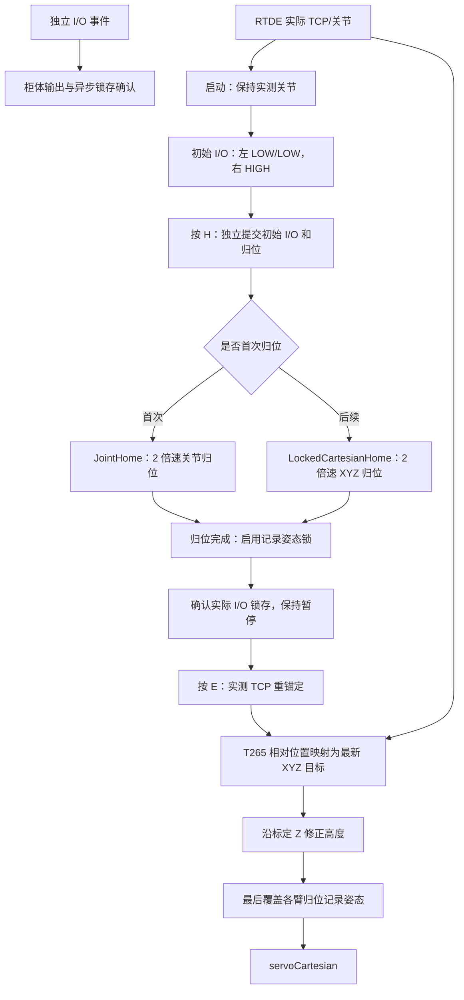

# AUBO 双臂遥操作 v3：现场配置与改动记录

日期：2026-10-09。对照提交前基线 `938037f`，记录其后本次提交的改动。
入口：`demo_dual_teleop_aubo_v3.py`；环境：`robodiff`。

## 1. 现场高度以配置为准

高度数值由现场调试后确定，代码不固定某组下限。启动时以 `--config` 选中的
JSON 为准；未指定时使用 `diffusion_policy/envs/realword/aubo_t265/config/dual.json`。
修改 JSON 后需要重启程序。

本次提交时的快照：

| 配置文件 | 左臂最低高度 | 右臂最低高度 | 高度参考 |
| --- | --- | --- | --- |
| `dual.json` | −580 mm | −535 mm | `calibrated_base` |
| `dual_no_smoothing.json` | −570 mm | −550 mm | `calibrated_base` |

`workspace.max_downward_distance` 填正数米值；实际下限为它的负值。
两份配置独立，选择无平滑配置不会自动继承 `dual.json` 的高度修改。
`target_margin=0.0`，允许恰好在边界。目标低于下限则投影到下限，真实反馈保留原值；
实际 TCP 低于下限时优先恢复到下限。

默认配置测试不再断言 −570/−550 mm，改为检查加载后的工作空间使用对应 JSON 的数值。
测试内单独构造的高度案例仍用于验证左右独立边界、投影、等号和错误反馈处理；
这些案例不要求现场配置采用它们的数值。

## 2. 当前控制链



实时位置继续覆盖更新，不使用 action chunk 或绝对到达期限。
策略排程仍保留 `PoseTrajectoryInterpolator`。I/O 事件独立排队，不随位置目标合并。
STOP、命令看门狗、RTDE 新鲜度和 SDK 返回码处理继续执行。

## 3. 固定标定 Z 与姿态顺序

两份配置均采用 `reference="calibrated_base"`。每臂初始化时读取保存的
`operator_basis_base[:, 2]`，作为在 BASE 中表达的固定向上轴。高度为：

```text
z_base = operator_basis_base[:, 2]
h = dot(z_base, tcp_xyz_base)
p_goal = tcp_xyz_base + max(0, minimum_height(side) - h) * z_base
最后覆盖 home_positions.json 对应臂的记录姿态
```

高度零点仍是各臂 BASE 原点；没有新增桌面原点或共同世界平移外参。
安装重力读取仍作核对，但不覆盖此模式的标定 Z，不逐帧更新高度轴。
旧 `gravity_base` 和 `world` 模式仍可显式选择。

## 4. 手动归位与两倍速

v3 入口选择手动归位：启动保持，不自动跳到归位记录姿态。
首次 H 使用渐进关节归位，完成后恢复记录姿态锁；之后 H 使用固定姿态的 XYZ 曲线。
没有增加启动姿态差阈值检查。首次归位结束前，E/R/Z/T 不开启固定姿态遥操。

`AuboInterpolationControllerV3.HOME_SPEED_SCALE = 2.0` 同时用于首次和后续归位。
相同起终点的轨迹时长减半，五次曲线形状不变；规划速度是原来的两倍，规划加速度四倍。
控制频率、`servo_t`、柜体速度比例和人控目标处理不变，实际速度仍取决于柜体跟随。
高度恢复后重建归位时保留倍率。共享归位类默认倍率为 1，其他入口不自动加速。

## 5. 启动与 H 的 I/O 一致性

| 输出 | 启动电平 | H 归位恢复电平 |
| --- | --- | --- |
| 左 DO00 | LOW | LOW |
| 左 DO01 | LOW | LOW |
| 右 DO00 | HIGH | HIGH |

启动和 H 共用 `_request_initial_output_state()`，保留其他配置引脚的电平。
H 同步更新主程序的输出缓存，因此下一次右臂按键切换由 HIGH 到 LOW。
H 的请求不等待 I/O 反馈，不增加睡眠等待；运动完成时 `_confirm_home_outputs()`
核对实际锁存，确认后再提示归位完成。

旧 I/O 实现只在写入后立即读取一次，若读到旧电平，缓存可能一直不更新，导致启动确认误报。
`AuboDigitalGripper.poll_feedback()` 在目标尚未确认时，以最多 10 Hz 继续只读锁存，
v2/v3 控制循环发布更新后的反馈；确认后停止轮询。没有重复写输出或用目标伪造反馈。
启动确认失败时输出具体引脚的实际值和目标值。锁存不代表夹爪物理到位。

## 6. 本次提交的文件范围

| 文件 | 改动 |
| --- | --- |
| `demo_dual_teleop_aubo_v2.py` | 标定 Z 模式不被安装重力覆盖，更新处理顺序注释 |
| `demo_dual_teleop_aubo_v3.py` | 手动归位、初始右 HIGH、启动/H 共用 I/O、归位完成确认及缓存更新 |
| `aubo_gripper.py` | 异步输出锁存轮询、重复请求读取真实反馈 |
| `aubo_homing.py` | 可选归位倍率、固定姿态归位重建保留倍率 |
| `aubo_interpolation_controller_v2.py` | 发布前刷新尚未确认的 I/O 锁存 |
| `aubo_interpolation_controller_v3.py` | 手动首次归位、两倍速、I/O 锁存刷新、伺服失败诊断 |
| `dual_aubo_real_env_v3.py` | 向两臂控制器传递 `manual_home` |
| `workspace.py` | 固定标定 Z 模式、禁止实时重力覆盖、复用投影/恢复/姿态出口 |
| `config/dual.json`、`config/dual_no_smoothing.json` | 选择标定 Z；保留各自现场高度配置 |
| `tests/test_calibrated_height.py`、`test_arm_height_limits.py` | 标定 Z、动态配置下限、左右边界逻辑 |
| `tests/test_manual_home_v3.py` | 启动保持、首次 H、完成锁定、错误诊断 |
| `tests/test_io_feedback.py` | 延迟锁存、轮询频率、初始右 HIGH、真实超时 |
| `tests/test_home_speed_io_v3.py` | 半时长同路径、倍率重建、H 的 I/O 及缓存恢复 |
| `test_gravity_height.py`、`test_height_recovery.py`、`test_servo_cartesian_v3.py` | 旧重力案例显式选择模式，保持与默认配置独立 |
| 根 README、AUBO README/v2/v3、v2 改动记录及本文件 | 更新入口、当前配置规则和本次控制行为 |

表中未带路径的控制模块位于 `diffusion_policy/envs/realword/`，配置、测试和 AUBO README 位于其 `aubo_t265/` 子目录。

## 7. 验证和运行

本次 174 项相关离线回归通过；v3 两份配置的 `--check-config` 通过。
测试使用 SDK/机器人替身；本次修改未发送真机运动或 I/O 指令。
此前只读查询时左右柜体为 Running/Normal，输出锁存读取正常；不据此宣称新版已完成真机验证。

```bash
cd /home/hy/Desktop/dp_pro6000
conda activate robodiff

# 仅检查配置，不连接设备
python demo_dual_teleop_aubo_v3.py --enable-io --check-config

# 使用 dual.json；启动后 H 归位，再 E 遥操
python demo_dual_teleop_aubo_v3.py \
  --enable-motion --enable-io --output data/aubo_v3_demo

# 独立无平滑配置：注意它使用自己的高度数值
python demo_dual_teleop_aubo_v3.py \
  --config diffusion_policy/envs/realword/aubo_t265/config/dual_no_smoothing.json \
  --enable-motion --enable-io --output data/aubo_v3_no_smoothing
```
